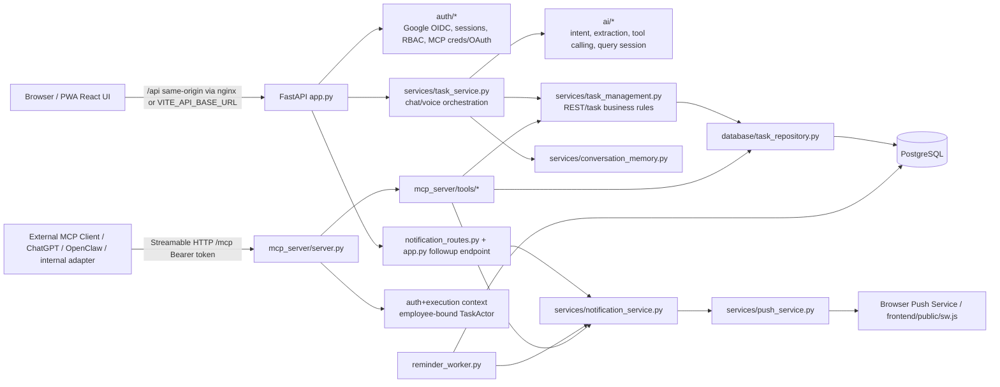

# Task Flow Automation / FnW Logging Assistant — Complete Handover README

> **Purpose:** single-source handover for another coding agent/system to understand, run, debug, extend, and deploy this repository safely.  
> **Status labels used:** **Implemented** = present in code/config; **Verified (static)** = confirmed by repository inspection in this workspace; **Runtime-dependent / Not verified here** = requires live DB, credentials, browser, external services, or full CI/runtime execution.

---

## 0. Fast Orientation (read this first)

| Item | Value |
|---|---|
| Repository | `/root/task-flow-automations` (git repo) |
| Remote | `origin https://github.com/AbhayShinde16325/FnW-logging-assistant.git` |
| Current branch | `master` |
| HEAD | `7da2ef8398109eafa679998c3e899528f3861624` (`7da2ef8 test: accept proactive follow-up in voice flow assertion`) |
| `origin/master` | same as local `master` (verified at handover time) |
| `feat/dual-mode-mcp` | same commit as `master` (verified at handover time) |
| Working tree | clean at handover time |
| Stack | FastAPI + SQLAlchemy/PostgreSQL + React/Vite + Docker Compose + MCP Streamable HTTP + Web Push/VAPID |
| Primary app entry | `app.py` |
| Worker entry | `reminder_worker.py` |
| Frontend entry | `frontend/src/main.jsx`, `frontend/src/App.jsx` |
| DB migrations | Alembic in `migrations/`, startup hook in `docker-entrypoint.sh` / `app.py` lifecycle |
| MCP endpoint | `/mcp` (mounted in FastAPI when `MCP_ENABLED=true`) |

**Do not commit secrets:** `.env`, `secrets/`, `tunnel/secrets/*`, VAPID private key, OAuth client secret, DB credentials, MCP bootstrap credential files, tunnel control-plane key.

---
## 1. Executive Summary

Task Flow Automation is an employee-scoped task management system. It accepts natural-language task operations through chat/text/voice, extracts/validates structured task data, stores tasks in PostgreSQL, enforces authentication and RBAC, sends reminder/push notifications, and exposes the same business capabilities through a provider-neutral MCP server.

**Core capabilities (Implemented):**
- Google OIDC sign-in (Authorization Code + PKCE), DB-backed sessions, refresh token rotation/reuse detection, CSRF protection, RBAC permissions.
- Employee-scoped task CRUD and chat-driven task workflows (create/update/get/list/delete, confirmations, clarifications, cancellation/backtracking, post-execution follow-up).
- Notification center, assignment/missing-field follow-up notifications, in-app read/delete, Web Push subscriptions, reminder worker with claim/retry/stale recovery.
- MCP Streamable HTTP server mounted in FastAPI; tool registry exposes task/employee/notification/database/agent tools with permission checks and task-actor scoping.
- Dockerized deployment: backend, reminder-worker, frontend/nginx; optional local Postgres overlay; optional dev MCP tunnel profile.

**Important runtime caveats:**
- `docker-compose.yml` defaults `RUN_MIGRATIONS=0` for backend. For production/external DB deployments, run migrations intentionally and exactly once before serving traffic.
- Full pytest suite (676 collected) was not completed in this environment due timeout; targeted verification passed. See [Testing & Verification](#15-testing-verification-and-known-gaps).
- `test_integration.py` is a manual script (no pytest collection side effects) and requires live AI/DB credentials.

---
## 2. System Architecture



### Design boundaries
- **Routes/controllers** (`app.py`, `auth/*routes.py`, `notification_routes.py`): HTTP parsing, auth dependencies, response shaping.
- **Services** (`services/*`): business rules, ownership checks, task workflow, reminders, memory, agent behavior.
- **Repositories/DB layer** (`database/*`): SQLAlchemy models, SQL validation/execution, task CRUD/search.
- **MCP layer** (`mcp_server/*`): capability boundary only; wraps existing services; no duplicate business logic.
- **Frontend** (`frontend/src/*`): UI state, auth token handling, notification UX, PWA/SW.

---
## 3. Repository Inventory (tracked files)

> Total tracked files: **193**. This section covers every tracked file by purpose and linkage. Generated caches (`__pycache__`, `.pytest_cache`) and local secrets/artifacts are not tracked.

### 3.1 Root / governance / deployment

| File | Purpose | Key links |
|---|---|---|
| `.dockerignore` | Excludes secrets, git metadata, caches, local DB/tunnel artifacts from Docker build context. | Used by `Dockerfile`. |
| `.env.example` | Canonical env var template with deployment notes (Supabase/pooler, MCP dev/prod, auth, push, reminders). | Read by operators; values consumed by `config.py`, `auth/config.py`, `mcp_server/configuration.py`, `database/connection.py`, compose. |
| `.gitignore` | Prevents committing env/secrets/caches/builds/tunnel creds. Includes `/secrets/`, `/vapid-generated.env`. | Git safety. |
| `AGENTS.md` | Repo-local agent instructions: SQL/task rules, confirmation phrases, DB agent behavior, notification follow-up behavior. | Must be read before SQL/agent changes. |
| `DATABASE_SCHEMA.md` | Human-readable schema contract for `tasks` and related DB behavior. | Used by SQL generation/agent work. |
| `Dockerfile` | Backend image: Python 3.12 slim, deps, non-root `app`, whisper cache, entrypoint, uvicorn CMD. | `docker-compose.yml`, `docker-entrypoint.sh`. |
| `README.md` | Existing project README/quick start. | General docs; this handover is more exhaustive. |
| `alembic.ini` | Alembic config. | `migrations/env.py`. |
| `app.py` | Main FastAPI app: config load, auth, CORS, MCP mount, task/chat/voice endpoints, notification follow-up respond endpoint. | Imports nearly all major services/auth/mcp modules. |
| `config.py` | App timezone and required task fields defaults. | `ai/query_session.py`, `datetime_resolver`, reminders/services. |
| `conftest.py` | Pytest root config: sets test auth defaults, deterministic draft clock fixture. | Affects test behavior globally. |
| `docker-compose.yml` | Default external-DB stack: backend, reminder-worker, frontend, optional dev mcp-tunnel profile. | `.env`, Dockerfiles, entrypoint, worker. |
| `docker-compose.local-db.yml` | Overlay for local Postgres dev/testing. | Overrides backend/reminder-worker DB and adds `db`. |
| `docker-entrypoint.sh` | Prepares cache, copies bootstrap MCP credential to app-readable path, runs migrations only when `RUN_MIGRATIONS` enabled, execs app. | `Dockerfile`, compose env. |
| `handover-readme.md` | This document. | N/A. |
| `notification_routes.py` | Notifications/push API router. | `app.py`, `services/notification_service.py`, `services/push_service.py`. |
| `reminder_worker.py` | Standalone reminder polling worker. | `services/notification_service.py`. |
| `requirements.txt` | Python dependencies. | `Dockerfile`, local dev. |
| `test_integration.py` | Manual AI+DB integration script; safe for pytest collection. | `ai.text_extractor`, `database.connection/task_repository`. |

### 3.2 `.agents/skills/`

| File | Purpose | Links |
|---|---|---|
| `.agents/skills/reminder-notifications/SKILL.md` | Operational rules for reminders/notifications/push behavior. | `services/notification_service.py`, `services/push_service.py`, notification routes. |
| `.agents/skills/sql-generation/SKILL.md` | SQL safety/confirmation rules for task DB operations. | `database/sql_execution.py`, `database/sql_generator.py`, `services/database_agent.py`, `AGENTS.md`. |

### 3.3 `ai/` (intent, extraction, provider, MCP adapter, conversational state)

| File | Purpose | Links |
|---|---|---|
| `ai/__init__.py` | Package marker. | — |
| `ai/intent_detection.py` | Classifies message intent (`CREATE/UPDATE/DELETE/GET/LIST/GENERAL/CLARIFICATION`), detects explicit create/update/cancel/selection cues. | `services/task_service.py`, `services/database_agent.py`. |
| `ai/mcp_client/__init__.py` | MCP client package exports. | — |
| `ai/mcp_client/client.py` | Official MCP Streamable HTTP client wrapper, sync/async tool/resource/prompt calls, provider tool-calling bridge. | `services/task_agent.py`, `mcp_server/server.py`. |
| `ai/mcp_client/context.py` | Context var for per-request MCP access token propagation. | `app.py` middleware. |
| `ai/mcp_client/discovery.py` | MCP tool discovery/caching helper. | MCP client. |
| `ai/mcp_client/tool_adapter.py` | Converts MCP tool schemas to provider/tool-calling format. | tool calling/provider adapters. |
| `ai/providers/__init__.py` | Package exports. | — |
| `ai/providers/base.py` | Base AI provider interface. | provider factory. |
| `ai/providers/cohere_provider.py` | Cohere provider implementation. | `ai/tool_calling.py`, extraction. |
| `ai/providers/provider_factory.py` | Selects provider by `AI_PROVIDER`; Cohere implemented, OpenAI placeholder. | app/service startup paths. |
| `ai/query_session.py` | Draft/session engine for staged task create/update/select/confirm flows; required fields, reminders, clarification behavior. | `services/task_service.py`, `ai/text_extractor.py`. |
| `ai/reminder.py` | Reminder parsing/validation helpers. | query/session/task services. |
| `ai/text_extractor.py` | Structured task extraction from natural language (Cohere/Pydantic schema), status/progress sync helpers. | `services/task_service.py`, `services/task_management.py`. |
| `ai/tool_calling.py` | Provider-agnostic tool-calling types/client wrapper, retries/errors/assistant turns. | database agent, MCP client. |

### 3.4 `auth/` (authentication, RBAC, employee management, MCP auth)

| File | Purpose | Links |
|---|---|---|
| `auth/__init__.py` | Package exports. | — |
| `auth/audit.py` | Audit logger helper for security-sensitive events. | employee/mcp credential flows. |
| `auth/bootstrap.py` | CLI/bootstrap helpers for first admin/RBAC seeding. | `python -m auth.bootstrap`, roles/permissions. |
| `auth/config.py` | Auth settings loader/validation (Google OIDC, cookie/JWT settings, secure config checks). | `app.py`, auth routes, security. |
| `auth/dependencies.py` | FastAPI dependencies: current employee, permission checks. | all protected routes. |
| `auth/employee_routes.py` | Admin/manager employee management endpoints and employee MCP credential admin actions. | `auth/employee_service.py`, `auth/mcp_credentials.py`. |
| `auth/employee_service.py` | Employee CRUD/activation/deactivation/session revocation, admin protections. | routes, RBAC DB models. |
| `auth/google.py` | Google OIDC authorization URL, token exchange, ID token verification. | `auth/routes.py`. |
| `auth/login.py` | Login helpers (small module). | auth flow. |
| `auth/mcp_credential_routes.py` | Self-service MCP credential create/list/revoke endpoints. | `auth/mcp_credentials.py`. |
| `auth/mcp_credentials.py` | MCP client credential generation/hash/store/revoke/validate/bootstrap reconciliation. | MCP auth, routes, startup. |
| `auth/mcp_oauth.py` | MCP OAuth (RFC 7591/9728/8414-aligned pieces) client registration, metadata, auth code/refresh/revoke, PKCE/resource binding. | `auth/mcp_oauth_routes.py`, MCP metadata. |
| `auth/mcp_oauth_routes.py` | OAuth endpoints for MCP clients: metadata, authorize, register, token, revoke, callback. | `app.py`, `auth/routes.py`, `mcp_server/server.py`. |
| `auth/permissions.py` | Canonical permission constants and role mappings. | RBAC checks/services. |
| `auth/routes.py` | Google login/callback, CSRF, refresh, logout, me endpoints; session cookies; MCP OAuth completion path. | `app.py`, frontend auth. |
| `auth/security.py` | JWT/state/CSRF/PKCE/token hash utilities and secure comparisons. | auth routes/service/MCP OAuth. |
| `auth/service.py` | Authenticated employee model, session create/rotate/revoke/reuse detection, Google employee linking. | auth routes, dependencies. |

### 3.5 `database/` (models, connection, SQL safety, task repo/search)

| File | Purpose | Links |
|---|---|---|
| `database/__init__.py` | Package marker. | — |
| `database/connection.py` | DB URL normalization (Supabase/pooler/ssl/prepared statements), engine/session/Base, `create_tables`, lightweight column patching. | all DB modules, Alembic/runtime. |
| `database/crud_demo.py` | Manual/demo CRUD script. | development only. |
| `database/models.py` | SQLAlchemy models: RBAC, auth sessions, MCP credentials/OAuth, tasks, notifications, push subscriptions, conversation memory. | entire app. |
| `database/read_planner.py` | Schema-aware read planning/repair for zero-row task reads. | database agent/agentic read. |
| `database/search.py` | Task text normalization/ranking/candidate search. | task repository/service. |
| `database/sql_execution.py` | SQL validation, confirmation enforcement, parameter binding, read-only/bounded execution rules. | database agent, task tools. |
| `database/sql_generator.py` | Deterministic structured operation -> SQL generation path. | task service fallback. |
| `database/task_fields.py` | Task field metadata/mapping/serialization helpers. | services, agent, serializers. |
| `database/task_repository.py` | Task CRUD/search/list operations; DB access boundary for tasks. | task management/service/MCP tools. |

### 3.6 `datetime_resolver/`

| File | Purpose | Links |
|---|---|---|
| `datetime_resolver/__init__.py` | Exposes resolver API. | `services/task_service.py`, reminder parsing. |
| `datetime_resolver/models.py` | Parsed/resolved datetime models. | resolver/parser. |
| `datetime_resolver/parsing.py` | Natural-language date/time parsing. | resolver. |
| `datetime_resolver/resolver.py` | Resolves relative/natural datetimes with timezone and fixed-now support. | task create/update/reminder flows. |
| `datetime_resolver/rules.py` | Resolution rules/defaults. | resolver. |

### 3.7 `docs/`

| File | Purpose | Links |
|---|---|---|
| `docs/MCP_ARCHITECTURE.md` | MCP dev/prod architecture, auth, endpoint, tool/resource/prompt inventory, deployment notes. | `mcp_server/*`, `.env.example`, deployment. |

### 3.8 `frontend/` (React/Vite PWA)

| File | Purpose | Links |
|---|---|---|
| `frontend/.dockerignore` | Frontend Docker build exclusions. | frontend Dockerfile. |
| `frontend/.gitignore` | Frontend local ignores. | dev. |
| `frontend/Dockerfile` | Build React app, serve via nginx. | compose frontend service. |
| `frontend/README.md` | Vite template README (basic). | dev reference. |
| `frontend/eslint.config.js` | ESLint config. | `npm run lint`. |
| `frontend/index.html` | SPA HTML shell. | Vite build. |
| `frontend/nginx.conf` | Serves SPA, proxies `/api/` to backend, no-cache for SW/manifest. | frontend container. |
| `frontend/package-lock.json` | Locked npm dependency graph. | reproducible build. |
| `frontend/package.json` | Scripts/deps: dev/build/lint/test/preview. | frontend CI/dev. |
| `frontend/public/favicon.svg` | Favicon asset. | UI. |
| `frontend/public/icons.svg` | Icon sprite. | UI. |
| `frontend/public/manifest.webmanifest` | PWA manifest. | installability/mobile. |
| `frontend/public/sw.js` | Service worker: push display/click handling, notification behavior. | push notifications. |
| `frontend/src/App.css` | Main styling including notification panel, responsive/mobile fixes. | App UI. |
| `frontend/src/App.jsx` | Main SPA: auth bootstrap, chat/voice/task/employee/notification UI, deep links, follow-up actions. | backend APIs, helper modules. |
| `frontend/src/assets/hero.png` | UI asset. | App. |
| `frontend/src/assets/react.svg` | Asset. | template residue. |
| `frontend/src/assets/vite.svg` | Asset. | template residue. |
| `frontend/src/assistantAlerts.js` | Assistant alert/announcement helpers. | notifications/UI. |
| `frontend/src/assistantAlerts.test.js` | Node test for assistant alerts. | `npm test`. |
| `frontend/src/auth.js` | API base, auth endpoints, CSRF cookie, refresh/login/logout helpers. | App auth flow. |
| `frontend/src/greeting.js` | Greeting text helper. | App. |
| `frontend/src/greeting.test.js` | Node test. | `npm test`. |
| `frontend/src/index.css` | Base/global styles. | main.jsx. |
| `frontend/src/main.jsx` | React bootstrap. | App.jsx. |
| `frontend/src/notifications.js` | Notification normalization, deep-link parsing, push permission/payload helpers, follow-up helper. | App.jsx, SW integration. |
| `frontend/src/notifications.test.js` | Node tests. | `npm test`. |
| `frontend/src/permissions.js` | Frontend permission/role helper mirroring backend RBAC intent. | App UI gating. |
| `frontend/src/permissions.test.js` | Node tests. | `npm test`. |
| `frontend/vite.config.js` | Vite config; dev proxy `/api` to backend. | local dev. |

### 3.9 `mcp_server/` (MCP server/capability boundary)

| File | Purpose | Links |
|---|---|---|
| `mcp_server/__init__.py` | Package marker. | — |
| `mcp_server/configuration.py` | MCP settings: enabled/path/auth/public URL/tunnel mode/transport/security/timeouts. | server, app, docs. |
| `mcp_server/prompts/__init__.py` | Package marker. | — |
| `mcp_server/prompts/agent_prompts.py` | MCP prompts exposed to clients. | server. |
| `mcp_server/registry/__init__.py` | Package marker. | — |
| `mcp_server/registry/tool_registry.py` | Central tool registry, spec metadata, permission filtering, unique names. | all MCP tools. |
| `mcp_server/resources/__init__.py` | Package marker. | — |
| `mcp_server/resources/application_resources.py` | App/MCP docs resources. | server. |
| `mcp_server/resources/skill_resources.py` | Exposes repo skill docs as MCP resources. | server/resources. |
| `mcp_server/security/__init__.py` | Package marker. | — |
| `mcp_server/security/authentication.py` | ASGI auth middleware for `/mcp`; Bearer token required; 401 + protected resource metadata. | server, MCP OAuth. |
| `mcp_server/security/authorization.py` | Tool permission checks. | registry/tool execution. |
| `mcp_server/security/execution_context.py` | Resolves bearer token to employee/TaskActor execution context (JWT or `fnw_mcp_` credential). | tools, auth services. |
| `mcp_server/server.py` | Builds MCP Server, registers tools/resources/prompts, Streamable HTTP session manager, mount/metadata routes. | `app.py`, tool modules. |
| `mcp_server/tools/__init__.py` | Package marker. | — |
| `mcp_server/tools/agent_tools.py` | Agent/conversation helper MCP tools. | services/database_agent/conversation. |
| `mcp_server/tools/common.py` | Shared tool helpers/schemas/errors. | tool modules. |
| `mcp_server/tools/database_tools.py` | Read-only schema/query/validation tools. | `database/sql_execution.py`, task repo. |
| `mcp_server/tools/employee_tools.py` | Employee lookup/management-related MCP tools where permitted. | auth/employee services. |
| `mcp_server/tools/notification_tools.py` | Notification MCP tools. | notification service. |
| `mcp_server/tools/task_tools.py` | Task CRUD/search/reminder/status/progress MCP tools. | `services/task_management.py`, repo. |

### 3.10 `migrations/`

| File | Purpose | Links |
|---|---|---|
| `migrations/env.py` | Alembic environment config, DB URL from env/app settings. | alembic.ini, models. |
| `migrations/script.py.mako` | Migration template. | alembic. |
| `migrations/versions/0001_auth_rbac.py` | Initial auth/RBAC tables and task/conversation ownership columns. | auth/models. |
| `migrations/versions/0002_rbac_task_policy.py` | RBAC policy fixes/backfills. | permissions/ownership. |
| `migrations/versions/0002a_create_core_tables.py` | Core tables baseline. | task/memory tables. |
| `migrations/versions/0003_reminder_notifications.py` | Notifications, push subscriptions, employee timezone. | reminders/push. |
| `migrations/versions/0004_intelligent_notification_fields.py` | Notification priority/voice/payload metadata. | notification intelligence. |
| `migrations/versions/0005_ensure_notification_metadata.py` | Ensures notification metadata columns. | idempotent schema safety. |
| `migrations/versions/0006_employee_task_self_service.py` | Employee task self-service policy updates. | RBAC/task permissions. |
| `migrations/versions/0007_refresh_session_replacement.py` | Session replacement tracking for refresh reuse detection. | auth session rotation. |
| `migrations/versions/0008_add_mcp_client_credentials.py` | MCP client credentials table. | MCP auth. |

### 3.11 `scripts/`

| File | Purpose | Links |
|---|---|---|
| `scripts/check_oauth_config.py` | Safe OAuth config diagnostics (no secrets printed). | auth config/env. |
| `scripts/generate_vapid_keys.py` | Generates VAPID key pair; optional env file output with 0600 perms. | push setup. |

### 3.12 `services/` (business logic)

| File | Purpose | Links |
|---|---|---|
| `services/agentic_read.py` | Agentic read repair/planning for zero-row results. | read planner, DB agent. |
| `services/conversation_memory.py` | Conversation memory persistence/retrieval/feedback in DB. | task service, DB agent. |
| `services/database_agent.py` | LLM-controlled DB agent: schema inspect, SQL generate/validate/execute/read/write with strict rules. | `ai/tool_calling.py`, `database/sql_execution.py`, task repo. |
| `services/missing_field_followup.py` | Stores/fetches notification follow-up state in notification payload; detects missing fields. | task management, task service, notifications. |
| `services/notification_service.py` | Notification creation/list/read/delete, push subscription management, reminder scheduling/worker claim/delivery/retry/cancel. | DB models, push service, worker/routes. |
| `services/push_service.py` | VAPID/Web Push send; handles invalid subscriptions. | notification worker/routes. |
| `services/query_rewriter.py` | Rewrites follow-up messages into standalone instructions using memory; safety checks. | task service before agent flow. |
| `services/task_agent.py` | MCP-backed or provider-backed task agent adapter helpers. | `ai/mcp_client`, task service. |
| `services/task_management.py` | Authorized task CRUD/progress/update/delete operations, assignment notifications, validation. | REST endpoints, MCP tools, task service. |
| `services/task_scope.py` | TaskActor model, contextvars, ownership/permission checks. | auth/MCP/task services. |
| `services/task_service.py` | Main orchestration for chat/voice: intent, staged create/update, confirmations, cancellation, notification follow-up, memory, DB agent/fallback. | app routes, AI, DB, notifications. |
| `services/task_tools.py` | Tool wrappers/helpers for task operations. | agent/MCP/service integration. |

### 3.13 `sheets/`, `tasks/`, `dashboard/`

| File | Purpose | Links |
|---|---|---|
| `sheets/google_sheets.py` | Placeholder/empty module (currently no implementation). | none active. |
| `tasks/task_manager.py` | Placeholder/empty module. | none active. |
| `dashboard/employee_dashboard.py` | Placeholder/empty module. | none active. |

### 3.14 `tests/` (pytest)

| File | Focus |
|---|---|
| `tests/test_agentic_field_retrieval.py` | Agentic field retrieval behavior. |
| `tests/test_assignment_notifications.py` | Assignment notification creation/payload behavior. |
| `tests/test_auth_rbac.py` | Auth/RBAC rules. |
| `tests/test_auth_refresh_postgres.py` | Refresh token/session behavior on Postgres. |
| `tests/test_auth_service_db.py` | Auth service DB behavior. |
| `tests/test_conversation_memory.py` | Conversation memory persistence/rewrite context. |
| `tests/test_database_agent.py` | DB agent planning/tool behavior. |
| `tests/test_datetime_resolver.py` | Natural datetime resolution. |
| `tests/test_employee_management.py` | Employee admin routes/service rules. |
| `tests/test_extraction_models.py` | Extraction schema/model validation. |
| `tests/test_extraction_output.py` | Extraction output handling. |
| `tests/test_intent_detection.py` | Intent classifier rules. |
| `tests/test_mcp_bootstrap_reconciliation.py` | MCP bootstrap credential reconciliation. |
| `tests/test_mcp_client_credentials.py` | MCP credential lifecycle/auth. |
| `tests/test_mcp_deployment_modes.py` | MCP dev/prod mode config behavior. |
| `tests/test_mcp_oauth.py` | MCP OAuth flows. |
| `tests/test_mcp_oauth_audit.py` | MCP OAuth audit/behavior checks. |
| `tests/test_mcp_server.py` | MCP server tools/resources/auth behavior. |
| `tests/test_missing_field_followup.py` | Missing field detection. |
| `tests/test_notification_followup_context.py` | Notification follow-up context/chat behavior. |
| `tests/test_query_session.py` | Staged query/session behavior. |
| `tests/test_rbac_task_api.py` | RBAC on task APIs. |
| `tests/test_read_planner.py` | Read planner behavior. |
| `tests/test_reminder.py` | Reminder parsing/scheduling basics. |
| `tests/test_reminders_notifications.py` | Reminder/notification delivery logic. |
| `tests/test_response_feedback.py` | Feedback endpoint/storage. |
| `tests/test_sql_execution.py` | SQL validation/confirmation/binding. |
| `tests/test_sql_generator.py` | SQL generation rules. |
| `tests/test_sql_skill_docs.py` | Skill/docs consistency checks. |
| `tests/test_task_cancellation.py` | Chat cancellation/backtrack behavior. |
| `tests/test_task_flows_db.py` | DB-backed task flows. |
| `tests/test_task_flows_regression.py` | Regression task flows. |
| `tests/test_task_intents.py` | Task intent handling. |
| `tests/test_task_intents_db.py` | DB-backed intent flows. |
| `tests/test_task_proactive_followup.py` | Post-execution follow-up nudges. |
| `tests/test_task_search.py` | Task search/ranking. |
| `tests/test_task_service.py` | Task service/chat endpoint behavior. |
| `tests/test_tool_calling.py` | Tool calling wrapper/provider behavior. |
| `tests/test_voice.py` | Voice transcription/validation. |
| `tests/test_voice_flow.py` | Voice turn flow; includes proactive follow-up tolerant assertion. |

### 3.15 `tunnel/`

| File | Purpose | Links |
|---|---|---|
| `tunnel/Dockerfile` | Builds tunnel client image for dev OpenAI tunnel. | compose `mcp-tunnel` profile. |
| `tunnel/config/fnw-chatgpt.compose.yaml` | Tunnel profile config. | compose volume mount. |
| `tunnel/entrypoint.sh` | Tunnel startup/credential checks. | tunnel container. |

### 3.16 `voice/`

| File | Purpose | Links |
|---|---|---|
| `voice/__init__.py` | Package exports. | app imports. |
| `voice/speech_to_text.py` | Faster-Whisper transcription, validation, temp-file handling, error mapping. | `/tasks/voice*`. |
## 4. API Surface (HTTP)

### 4.1 App routes (`app.py`)

| Method | Path | Auth/Perm | Purpose | Main implementation |
|---|---|---|---|---|
| POST | `/feedback` | `TASKS_READ` | Store response feedback. | `app.handle_feedback` -> `services.conversation_memory.update_response_feedback` |
| POST | `/tasks/feedback` | `TASKS_READ` | Alias for feedback. | same |
| GET | `/health` | none | Liveness. | `health_check` |
| GET | `/tasks` | `TASKS_READ` | List visible tasks. | `task_management.list_tasks_for_actor` / repo |
| POST | `/tasks` | `TASKS_CREATE` | Create task. | `task_management.create_task` |
| PATCH | `/tasks/{task_id}` | `TASKS_UPDATE` | Update task fields. | `task_management.update_task` |
| PATCH | `/tasks/{task_id}/progress` | `TASKS_UPDATE` | Update progress (self-service allowed by policy). | `task_management.update_task` |
| DELETE | `/tasks/{task_id}` | `TASKS_DELETE` | Delete with confirmation semantics in service layer. | `task_management.delete_task` |
| GET | `/tasks/{task_id}` | `TASKS_READ` | Read one task. | `task_management.get_task_for_actor` |
| POST | `/tasks/text` | any task turn permission | One text turn; wraps chat flow. | `process_chat_turn` |
| POST | `/notifications/{notification_id}/followup/respond` | `TASKS_READ` | Accept/dismiss missing-field follow-up for notification owner. | `services.missing_field_followup.respond_assignment_followup` |
| POST | `/tasks/chat` | any task turn permission | Main conversational turn; supports `notification_id`. | `process_chat_turn` |
| POST | `/tasks/voice` | any task turn permission | Voice upload -> transcript -> chat/voice turn. | `process_voice_turn` / `transcribe_audio` |
| POST | `/tasks/voice/turn` | any task turn permission | Voice turn with conversation state. | same handler |

### 4.2 Auth routes (`auth/routes.py`, prefix `/auth`)

| Method | Path | Purpose |
|---|---|---|
| GET | `/auth/google/login` | Start Google OIDC PKCE flow; sets signed state cookie. |
| GET | `/auth/google/callback` | Validates state/nonce, exchanges code, verifies ID token, links/provisions active employee, creates session cookies. |
| GET | `/auth/csrf` | Bootstraps CSRF cookie. |
| POST | `/auth/refresh` | CSRF-protected refresh token rotation; reuse detection. |
| POST | `/auth/logout` | Revokes current session; clears cookies. |
| POST | `/auth/logout-all` | Revokes all sessions for employee. |
| GET | `/auth/me` | Returns authenticated employee + permissions. |

### 4.3 Employee management (`auth/employee_routes.py`, prefix `/employees`)

All require authenticated employee with `employees.manage`; admin-target actions require appropriate role permissions.

| Method | Path | Purpose |
|---|---|---|
| GET | `/employees` | List/search/filter employees. |
| GET | `/employees/{employee_id}` | Detail. |
| POST | `/employees` | Create/provision employee. |
| PATCH | `/employees/{employee_id}` | Update name/role with safeguards. |
| POST | `/employees/{employee_id}/deactivate` | Deactivate and revoke sessions. |
| POST | `/employees/{employee_id}/activate` | Activate. |
| POST | `/employees/{employee_id}/revoke-sessions` | Revoke sessions. |
| GET | `/employees/{employee_id}/mcp-credentials` | List employee MCP credentials. |
| POST | `/employees/{employee_id}/mcp-credentials/{credential_id}/revoke` | Revoke MCP credential. |

### 4.4 MCP credential self-service (`auth/mcp_credential_routes.py`, prefix `/auth/mcp-credentials`)

| Method | Path | Purpose |
|---|---|---|
| GET | `/auth/mcp-credentials` | List own MCP credentials. |
| POST | `/auth/mcp-credentials` | Create credential; plaintext returned once. |
| POST | `/auth/mcp-credentials/{credential_id}/revoke` | Revoke own credential. |

### 4.5 MCP OAuth (`auth/mcp_oauth_routes.py`)

| Method | Path | Purpose |
|---|---|---|
| GET | `/.well-known/oauth-authorization-server` | OAuth authorization server metadata. |
| GET | `/oauth/authorize` | OAuth authorization endpoint (PKCE/resource). |
| GET | `/auth/mcp/callback` | Internal MCP OAuth callback return path. |
| POST | `/oauth/register` | Dynamic client registration. |
| POST | `/oauth/token` | Authorization code / refresh token exchange. |
| POST | `/oauth/revoke` | Token revocation. |

### 4.6 Notifications & push (`notification_routes.py`)

| Method | Path | Auth | Purpose |
|---|---|---|---|
| GET | `/notifications` | `TASKS_READ` | List self notifications. |
| GET | `/notifications/unread-count` | `TASKS_READ` | Unread count. |
| GET | `/notifications/settings` | `TASKS_READ` | Timezone/push settings state. |
| PATCH | `/notifications/settings` | `TASKS_READ` | Update timezone. |
| PATCH | `/notifications/{notification_id}/read` | `TASKS_READ` | Mark read. |
| POST | `/notifications/read-all` | `TASKS_READ` | Mark all read. |
| DELETE | `/notifications/{notification_id}` | `TASKS_READ` | Delete one. |
| DELETE | `/notifications` | `TASKS_READ` | Delete all. |
| GET | `/push/public-key` | public/auth behavior as implemented | VAPID public key/config. |
| GET | `/push/subscriptions` | `TASKS_READ` | List own subscriptions. |
| POST | `/push/test` | `TASKS_READ` | Send test push. |
| POST | `/push/subscribe` | `TASKS_READ` | Register push subscription. |
| DELETE | `/push/subscribe` | `TASKS_READ` | Unsubscribe. |

### 4.7 MCP endpoint (`mcp_server/server.py`)

| Method | Path | Auth | Purpose |
|---|---|---|---|
| POST/GET/DELETE | `/mcp` (configurable) | Bearer `fnw_mcp_...` or MCP OAuth token; employee JWT not accepted for MCP endpoint | Streamable HTTP MCP protocol. |
| GET | `/.well-known/oauth-protected-resource` and path-specific variant | public metadata | RFC 9728 protected resource metadata. |

---
## 5. Core Business Flows

### 5.1 Authentication flow
1. Frontend calls `/auth/google/login` (or redirects browser) with `return_to`.
2. Backend creates PKCE verifier/challenge, state, nonce, signed state token cookie.
3. Google callback validated: state cookie + state param + ID token signature/iss/aud/nonce/email_verified.
4. Employee resolved by `google_sub` or pre-provisioned email; active required.
5. Session created: refresh token hash in DB, refresh cookie HttpOnly, CSRF cookie readable.
6. Frontend uses access token in memory; `/auth/refresh` rotates refresh token with CSRF header.

### 5.2 Task chat/voice flow
1. `/tasks/chat` or `/tasks/voice` receives message/audio + optional `conversation_id`, staged draft state, `notification_id`.
2. `app.py` resolves authenticated employee into `TaskActor` scope.
3. `services/task_service.py` loads conversation memory, normalizes message, detects intent.
4. For fresh turn: may route to database agent (`DATABASE_AGENT=1`) or deterministic/staged flow.
5. Staged create/update handles missing fields, confirmations, reminders, cancellation, backtrack.
6. Task mutations go through `task_management`/repository with RBAC and ownership checks.
7. Response includes status, intent, stage, draft, reply/message, task/tasks, follow-up context as applicable.
8. Memory stored in `conversation_memory`; feedback can be attached by `/feedback`.

### 5.3 Notification follow-up flow (latest feature)
1. Task assignment/missing details can create notification with payload metadata (`kind`, missing fields, followup status, action item context).
2. Frontend notification panel shows actionable notification; accept/dismiss calls `/notifications/{id}/followup/respond`.
3. `services/missing_field_followup.py` updates follow-up state in notification payload.
4. Chat can include `notification_id`; `task_service.py` loads notification context, enforces existing-task context, asks for missing details, and applies safe updates.
5. Proactive follow-up nudge: after successful task operation, assistant may ask "anything else?" with safeguards to avoid loops.

### 5.4 Reminder/push flow
1. Task with reminder date+time and employee timezone becomes schedulable notification.
2. `notification_service` stores/normalizes due notifications; dedupe/cancel stale unsent rows on task changes.
3. `reminder_worker.py` polls, claims due rows (`FOR UPDATE SKIP LOCKED`), commits claim, sends via `push_service`.
4. Delivery updates status/retry/dead-letter semantics; invalid subscriptions removed.
5. Frontend SW (`sw.js`) displays push; click opens/focuses app and deep-links to relevant task/notification context.

### 5.5 MCP flow
1. MCP client calls `/mcp` with Bearer token.
2. `MCPAuthenticationMiddleware` authenticates and builds execution context bound to employee.
3. `mcp_server.server` exposes tools filtered by permissions; `call_tool` rechecks authZ and runs with `use_task_actor`.
4. Tool handlers call existing services/repos; responses returned as structured MCP content.
5. No direct DB access from model/provider outside tool/service boundaries.

---
## 6. Data Model (SQLAlchemy)

Defined in `database/models.py`. Migrations in `migrations/versions/*`.

| Model | Table | Purpose | Key fields / relationships |
|---|---|---|---|
| `Role` | `roles` | RBAC role. | name, permissions, employees |
| `Permission` | `permissions` | RBAC permission. | name, roles |
| `RolePermission` | `role_permissions` | many-to-many role-permission. | role_id, permission_id |
| `Employee` | `employees` | User/assignee principal. | google_sub, name, email, role_id, is_active, timezone |
| `AuthSession` | `sessions` | Refresh session hash + rotation metadata. | employee_id, refresh_token_hash, expires_at, revoked_at, replaced_by_session_id |
| `MCPClientCredential` | `mcp_client_credentials` | Long-lived MCP credential hash. | employee_id, name, token_prefix/hash, expires/revoked/last_used |
| `MCPOAuthClient` | `mcp_oauth_clients` | Registered MCP OAuth client. | client_id, redirect_uris, grant_types, response_types, scope |
| `MCPOAuthCode` | `mcp_oauth_codes` | One-time auth code. | code_hash, client_id, employee_id, PKCE, resource, expires/used/revoked |
| `MCPOAuthSession` | `mcp_oauth_sessions` | Refreshable OAuth session for MCP. | employee_id, client_id, refresh hash, scopes/resource, revoked/expiry |
| `Task` | `tasks` | Core task record. | title/description, assigned_to/employee_id, created_by, dates/times, status, progress, reminder fields |
| `Notification` | `notifications` | In-app/push notification record. | employee_id, task_id, type, title/message, scheduled/read/delivery/retry/payload/priority |
| `PushSubscription` | `push_subscriptions` | Browser push subscription. | employee_id, endpoint, p256dh/auth keys, user agent, active flags |
| `ConversationMemory` | `conversation_memory` | Per-user/conversation state. | user_id/employee_id, conversation_id, messages/context, active task, response feedback |

### Important schema rules
- **SQL skill scope:** natural-language DB agent is limited to `tasks` table operations and strict validation.
- **Task ownership:** `assigned_to_employee_id` is source of truth for authorization; `assigned_to` name is display/legacy compatibility.
- **Reminder fields:** both date and time or neither; reminder must be before/at deadline; timezone-aware scheduling.
- **Notification dedupe:** unique constraint on `(employee_id, task_id, notification_type, scheduled_at)` used by worker idempotency.
- **Migrations:** apply through Alembic; `create_tables()` is not a substitute for production migration discipline.

---
## 7. Environment Variables (operator reference)

> See `.env.example` for full comments. Never commit real values.

### 7.1 Core
| Var | Default | Purpose |
|---|---:|---|
| `DATABASE_URL` | required | PostgreSQL/SQLAlchemy URL. Use Supabase session pooler when appropriate; transaction pooler needs prepared-statement disablement. |
| `DB_POOL_*`, `DB_CONNECT_TIMEOUT`, `DB_SSLMODE`, `DB_DISABLE_PREPARED_STATEMENTS` | optional | Engine/pool tuning. |
| `AI_PROVIDER` | `cohere` | AI provider selection. |
| `COHERE_API_KEY` | required for Cohere flows | LLM extraction/tool calling. |
| `TZ` | `Asia/Kolkata` | Timezone default. |
| `CORS_ORIGINS` | localhost dev defaults | Allowed browser origins. |
| `TASK_REQUIRED_FIELDS` | title,desc,assignee,deadline date/time | Staged create required fields. |

### 7.2 Auth / session
| Var | Default | Purpose |
|---|---:|---|
| `AUTH_REQUIRED` | `1` | Enforce auth; tests may set `0`. |
| `AUTH_SECRET_KEY` | required | JWT/session signing secret. |
| `GOOGLE_CLIENT_ID/SECRET` | required | Google OIDC. |
| `GOOGLE_REDIRECT_URI` | env-specific | Must match Google console. |
| `FRONTEND_URL` | localhost | Allowed frontend origins for redirects. |
| `AUTH_POST_LOGIN_REDIRECT` | frontend | Post-login redirect. |
| `AUTH_COOKIE_SECURE/SAME_SITE/DOMAIN` | dev-friendly | Cookie security. |
| `ACCESS_TOKEN_MINUTES` | 15 | Access token TTL. |
| `REFRESH_TOKEN_DAYS` | 14 | Refresh token TTL. |
| `BOOTSTRAP_ADMIN_EMAIL/NAME` | optional | Bootstrap first admin. |

### 7.3 MCP
| Var | Default | Purpose |
|---|---:|---|
| `APP_ENV` | `development` | dev/prod behavior switches. |
| `MCP_ENABLED` | `1` in compose default | Mount MCP server. |
| `MCP_TRANSPORT` | `streamable-http` | Transport type. |
| `MCP_PATH` | `/mcp` | Endpoint path. |
| `MCP_REQUIRE_AUTH` | `1` | Require bearer auth. |
| `MCP_SERVER_URL` | `http://127.0.0.1:8000/mcp/` | Internal adapter URL; keep local. |
| `MCP_PUBLIC_RESOURCE_URL` | empty | Public metadata/resource URL. |
| `MCP_TUNNEL_ENABLED` | dev default true/compose | Enables dev tunnel assumptions/bootstrap logic. |
| `MCP_STATELESS`, `MCP_JSON_RESPONSE` | `1` | HTTP transport behavior. |
| `MCP_ALLOWED_HOSTS/ORIGINS` | empty | DNS rebinding/origin controls. |
| `MCP_DNS_REBINDING_PROTECTION` | `0` | Enable in hardened env with allowlists. |

### 7.4 Notifications / push / worker
| Var | Default | Purpose |
|---|---:|---|
| `VAPID_PUBLIC_KEY` | empty | Web Push public key. |
| `VAPID_PRIVATE_KEY` / `VAPID_PRIVATE_KEY_PATH` | empty | Private key (secret). |
| `VAPID_SUBJECT` | `mailto:admin@example.com` | VAPID contact. |
| `REMINDER_POLL_SECONDS` | 20 | Worker poll interval. |
| `REMINDER_BATCH_SIZE` | 100 | Claim batch size. |
| `REMINDER_MAX_RETRIES` | 5 | Delivery retries. |
| `REMINDER_RETRY_BASE_SECONDS` | 30 | Retry backoff base. |
| `REMINDER_RETRY_MAX_SECONDS` | 3600 | Retry backoff max. |
| `REMINDER_MAX_AGE_HOURS` | 168 | Skip stale reminders. |
| `REMINDER_PROCESSING_TIMEOUT_SECONDS` | 300 | Recover stale processing claims. |
| `RUN_MIGRATIONS` | compose default `0` | Run Alembic on container startup when enabled. |

### 7.5 Frontend / voice / agent
| Var | Default | Purpose |
|---|---:|---|
| `VITE_API_BASE_URL` | `/api` in compose build | Frontend API base. |
| `FRONTEND_PORT` | 8080 | Host port. |
| `BACKEND_PORT` | 8000 | Host port. |
| `WHISPER_MODEL_SIZE/DEVICE/COMPUTE_TYPE` | small/cpu/int8 | Voice transcription. |
| `AGENTIC_READ` | `1` | Read repair/planning. |
| `DATABASE_AGENT` | `1` | LLM DB agent path. |

---
## 8. Local Development Setup

### 8.1 Prerequisites
- Docker Engine + Docker Compose v2 (`docker compose version`)
- Python 3.12+ and Node 20+ for non-Docker dev (optional)
- PostgreSQL/Supabase DB URL
- Google OAuth client (for real auth flow)
- Cohere API key (for AI flows)

### 8.2 Docker (recommended, external DB / Supabase)
```bash
cp .env.example .env
# edit .env: DATABASE_URL, COHERE_API_KEY, AUTH_SECRET_KEY, GOOGLE_* , VAPID_* as needed

# Build/start
docker compose up -d --build

# Check status/logs
docker compose ps
docker compose logs -f backend
docker compose logs -f reminder-worker
docker compose logs -f frontend

# Health
curl -fsS http://localhost:${BACKEND_PORT:-8000}/health
```

Open UI: `http://localhost:${FRONTEND_PORT:-8080}`.

### 8.3 Docker with local PostgreSQL overlay (isolated dev/test)
```bash
cp .env.example .env
# set POSTGRES_PASSWORD and local values as needed
docker compose -f docker-compose.yml -f docker-compose.local-db.yml up -d --build
```

### 8.4 Dev Docker Compose startup (attached logs, includes MCP tunnel)

Use this command from the project root when you want the development stack with the MCP tunnel and attached Compose logs:

```bash
docker compose --profile dev up
```

**What it does:**
- `--profile dev` enables services configured under the `dev` Docker Compose profile in `docker-compose.yml`. In the current Compose configuration, that includes `mcp-tunnel` (also profiled as `development`).
- `up` creates and starts the configured containers and attaches the terminal to their logs.
- With the current Compose configuration, this starts `backend`, `frontend`, `reminder-worker`, and `mcp-tunnel`. The default backend/frontend/reminder-worker services start because they have no profile; `mcp-tunnel` starts because the `dev` profile is enabled.
- Use `Ctrl+C` to stop the attached Compose process. This stops the attached services; containers may remain stopped rather than being removed. Use `docker compose ps` to inspect status and `docker compose down` only when you intentionally want to remove the Compose-managed containers/network.

**Illustrative startup output:**

```text
Network task-flow-automations_taskflow Created
Container task-flow-automations-backend-1 Created
Container task-flow-automations-frontend-1 Created
Container task-flow-automations-reminder-worker-1 Created
Attaching to backend-1, frontend-1, mcp-tunnel-1, reminder-worker-1
```

**Important startup observations:**
1. `RUN_MIGRATIONS disabled; skipping Alembic migrations.` means automatic Alembic migrations were skipped by the container entrypoint. Do **not** describe this as migrations having run successfully. If schema changes must be applied, run `alembic upgrade head` intentionally using the project's migration strategy.
2. `Database initialized successfully` and `Database tables created successfully` indicate that the application's database initialization/table-creation process completed successfully. Treat this as application-level initialization; it is separate from Alembic migration execution.
3. Docker's orphan-container warning about `task-flow-automations-db-1` means a container exists for this Compose project but is not defined in the current Compose configuration. Investigate it before removing it (for example, confirm whether it was created by `docker-compose.local-db.yml` or an older workflow and whether it contains needed local data). Do **not** recommend or run `docker compose down --remove-orphans` blindly, because it may remove a container still needed by the developer.

**Dev tunnel prerequisites:** the `mcp-tunnel` service requires tunnel configuration/secrets, including `CONTROL_PLANE_API_KEY` and the mounted tunnel profile/authorization files described in `.env.example` and `docker-compose.yml`. If you only need the core app stack without the tunnel, use the non-profile startup commands in sections 8.2 or 8.3.

### 8.5 Non-Docker backend/frontend dev
Backend:
```bash
python3 -m venv venv
source venv/bin/activate
pip install -r requirements.txt
cp .env.example .env  # configure values
alembic upgrade head
uvicorn app:app --reload --port 8000
```
Frontend (separate terminal):
```bash
cd frontend
npm install
npm run dev
```
Vite dev server proxies `/api` to `http://127.0.0.1:8000` by default.

---
## 9. Production Deployment Guide (Render / HTTPS)

> **Target:** same codebase, MCP enabled, no dev tunnel, HTTPS public endpoint.

### 9.1 Pre-deploy checklist
- [ ] Create production Postgres/Supabase DB; get secure `DATABASE_URL`.
- [ ] Set strong `AUTH_SECRET_KEY`.
- [ ] Configure Google OAuth Web client with production redirect URI.
- [ ] Set `APP_ENV=production`, `MCP_TUNNEL_ENABLED=false`, `MCP_REQUIRE_AUTH=true`.
- [ ] Set `MCP_PUBLIC_RESOURCE_URL=https://<your-domain>` (or full `/mcp` URL; server canonicalizes).
- [ ] Keep `MCP_SERVER_URL=http://127.0.0.1:8000/mcp` (internal only).
- [ ] Set VAPID keys for push (private key in secret manager/file mount, never in git).
- [ ] Set `FRONTEND_URL`, `AUTH_POST_LOGIN_REDIRECT`, `GOOGLE_REDIRECT_URI`, `CORS_ORIGINS` to production origins.
- [ ] Set `AUTH_COOKIE_SECURE=true` on HTTPS.
- [ ] Decide migration strategy: run `alembic upgrade head` once per deploy/release.

### 9.2 Build/run commands
Backend image uses `docker-entrypoint.sh` and `uvicorn app:app --host 0.0.0.0 --port ${PORT:-8000}`.

**Migration strategy (important):** compose currently defaults `RUN_MIGRATIONS=0`. For production, either:
1. Run a one-off release command: `alembic upgrade head` (preferred), or
2. Temporarily set `RUN_MIGRATIONS=1` for a single backend instance/release job, keep worker at `RUN_MIGRATIONS=0`.

Never run concurrent migrations from multiple replicas.

### 9.3 Render-specific notes
- Expose HTTPS endpoint: `https://<service>.onrender.com/mcp`.
- Do not include OpenAI tunnel profile/service in production.
- No `CONTROL_PLANE_API_KEY` needed in production direct MCP mode.
- Ensure persistent/managed secrets are set in Render dashboard, not files in repo.
- If using Supabase transaction pooler, set `DB_DISABLE_PREPARED_STATEMENTS=1` and tune pool sizes conservatively.

### 9.4 Post-deploy smoke tests
```bash
curl -fsS https://<host>/health
curl -i https://<host>/.well-known/oauth-protected-resource
curl -i https://<host>/mcp   # expect 401/metadata behavior without valid bearer
```
UI checks: Google login, `/auth/me`, task list/create, notification panel, push subscribe/test (HTTPS required), MCP credential creation, MCP client initialize/list_tools with `fnw_mcp_...` token.

### 9.5 Rollback / safety
- Rollback app code only after confirming DB migrations are backward-compatible.
- Do not downgrade Alembic blindly on production data.
- Keep previous image/tag available.
- Preserve VAPID private key; changing it invalidates existing subscriptions.

---
## 10. Security & RBAC Rules

### 10.1 Authentication
- Google OIDC only for human login; no public registration.
- Email must belong to pre-provisioned active employee; optional domain restriction.
- ID token verified: signature/JWKS, issuer, audience, nonce, expiry, email_verified.
- Access token short-lived JWT in memory; refresh token random opaque in HttpOnly cookie; only hash stored in DB.
- CSRF: double-submit cookie + `X-CSRF-Token` for refresh/logout-sensitive flows.
- Refresh rotation with reuse detection; revoked/reused token can revoke all employee sessions.

### 10.2 Authorization
- RBAC permissions enforced server-side (`auth/permissions.py`, dependencies, services).
- Task visibility/mutation scoped by `TaskActor` and `assigned_to_employee_id`.
- Employees cannot manage others' tasks outside granted permissions; cannot self-escalate roles/admin-protected targets.

### 10.3 MCP security
- `/mcp` requires Bearer auth when `MCP_REQUIRE_AUTH=true` (default).
- Accepted MCP identities: dedicated `fnw_mcp_...` credentials or MCP OAuth tokens; browser employee JWTs are rejected for MCP endpoint by design.
- Tool discovery filtered by permissions; tool execution re-checks permission and actor scope.
- MCP public metadata exposes resource/auth metadata, never secrets.

### 10.4 Secrets handling
Never commit/log: `.env`, DB passwords, Google client secret, `AUTH_SECRET_KEY`, VAPID private key, MCP credential plaintext, tunnel control-plane key, OAuth tokens/codes/verifiers.

---
## 11. Observability & Troubleshooting

### 11.1 Logs
- Backend: `docker compose logs -f backend` (uvicorn/FastAPI/app logs).
- Worker: `docker compose logs -f reminder-worker` (claim/send/retry logs).
- Frontend/nginx: `docker compose logs -f frontend`.
- Tunnel (dev profile): `docker compose logs -f mcp-tunnel`.

### 11.2 Common issues

| Symptom | Likely cause | Check/fix |
|---|---|---|
| 401 on `/auth/me` after refresh | missing/invalid CSRF, expired refresh, revoked session | verify cookies, `X-CSRF-Token`, session revocation, clock skew. |
| Google login redirects to auth error | misconfigured redirect URI, unprovisioned/inactive employee, domain restriction | `scripts/check_oauth_config.py`, Google console redirect URI, employee record. |
| MCP 401 | missing/invalid bearer, wrong token type for `/mcp` | use `fnw_mcp_...` or MCP OAuth token; check `MCP_REQUIRE_AUTH`, metadata endpoint. |
| MCP tools missing | permission-filtered by role/actor | verify employee role permissions and tool registry required permissions. |
| Push not received | no VAPID keys, HTTP origin, permission denied, stale subscription, iOS PWA constraints | `/push/public-key`, browser permission, SW registered, HTTPS, check worker logs. |
| Duplicate/old reminders | unsent rows not cancelled or worker retry confusion | check notification statuses, dedupe unique key, task update cancellation logic. |
| DB connection errors on Supabase | wrong pooler/SSL/prepared statement settings | `DATABASE_URL`, `DB_SSLMODE`, `DB_DISABLE_PREPARED_STATEMENTS`, pool sizes. |
| Chat says task missing but exists | ownership scope, wrong employee, stale conversation context, notification context mismatch | check `assigned_to_employee_id`, actor permissions, conversation memory, `notification_id` payload. |

### 11.3 Useful diagnostics
```bash
# OAuth config sanity (no secrets printed)
python scripts/check_oauth_config.py

# MCP metadata
curl -i http://localhost:8000/.well-known/oauth-protected-resource

# DB migrations status (inside env with DB access)
alembic current
alembic heads

# Frontend build
cd frontend && npm run build

# Frontend unit tests
cd frontend && npm test
```

---
## 12. Testing, Verification, and Known Gaps

### 12.1 Current verification evidence (this workspace session)
| Check | Result | Notes |
|---|---|---|
| `git status` | clean | before handover edits. |
| Targeted follow-up/task tests (previous) | **39 passed, 3 warnings** | `MCP_ENABLED=false DATABASE_AGENT=0 AGENTIC_READ=0 pytest ...` for missing field/assignment/notification/cancellation/proactive/task_service. |
| MCP-focused pytest (previous) | **25 passed** | `tests/test_mcp_server.py`, `mcp_oauth`, `mcp_oauth_audit`, `mcp_deployment_modes`. |
| Frontend build (previous) | **passed** | `npm run build` in `frontend`. |
| Frontend node tests (previous runs in repo history) | **pass expected / not rerun now** | `npm test` script exists. |
| Full pytest collection | **676 tests collected** | `python -m pytest --collect-only -q`. |
| Full pytest suite | **not completed** | timed out repeatedly in environment; batch execution also hit long-running DB/conversation-memory groups. |

### 12.2 Known gaps / caveats
- **Full backend suite incomplete in this environment.** Do not claim green CI/full regression pass.
- **Conversation-memory batch** previously timed out (>300s) in this environment; investigate DB fixtures/transaction slowness/isolation before CI reliance.
- **MCP lifespan reuse**: earlier `StreamableHTTPSessionManager .run() can only be called once per instance` observed in task service tests under MCP-enabled lifespan reuse; appears test-lifecycle/environment-sensitive. MCP-focused suites pass.
- **`test_integration.py`** is manual only; requires live Cohere + DB and writes data. Do not run in CI without isolation.
- **Runtime-dependent features not verified:** real Google OAuth, real Supabase/Render deployment, real browser push delivery, iOS PWA behavior, live MCP client interoperability.

### 12.3 Recommended CI command set
```bash
# backend static/safe collection
python -m pytest --collect-only -q

# focused critical suites
MCP_ENABLED=false DATABASE_AGENT=0 AGENTIC_READ=0 python -m pytest \
  tests/test_task_service.py tests/test_task_cancellation.py \
  tests/test_task_proactive_followup.py tests/test_missing_field_followup.py \
  tests/test_assignment_notifications.py tests/test_notification_followup_context.py -q

python -m pytest tests/test_mcp_server.py tests/test_mcp_oauth.py tests/test_mcp_oauth_audit.py tests/test_mcp_deployment_modes.py -q

# frontend
cd frontend && npm ci && npm test && npm run build
```

For full backend confidence, run in CI with proper DB service, timeouts, and split by marker/group.

---
## 13. Change-Management & Handoff Checklist

### 13.1 Before changing code
- [ ] Read `AGENTS.md`, `DATABASE_SCHEMA.md`, relevant `.agents/skills/*`.
- [ ] Identify if change touches auth/RBAC, task ownership, SQL validation, notification dedupe, or MCP auth. These are high-risk.
- [ ] Add/update tests next to affected area.

### 13.2 High-risk files
- `app.py`, `services/task_service.py`, `services/task_management.py`, `services/notification_service.py`
- `auth/routes.py`, `auth/service.py`, `auth/security.py`, `auth/permissions.py`
- `database/models.py`, `database/sql_execution.py`, `database/task_repository.py`, `migrations/versions/*`
- `mcp_server/server.py`, `mcp_server/security/*`, `mcp_server/tools/*`
- `frontend/src/App.jsx`, `frontend/public/sw.js`

### 13.3 Safe deployment rule
1. Merge feature -> master after verification.
2. Run migrations once.
3. Deploy backend.
4. Deploy reminder worker (same image/version).
5. Deploy frontend.
6. Smoke test auth, task chat, notification, push, MCP.
7. Monitor logs and error rates.

### 13.4 "If you only have 30 minutes"
- Read sections 0-5, 7, 9, 10, 12.
- Run `git status`, `docker compose ps`, `curl /health`.
- Inspect recent changes in `services/task_service.py`, `services/missing_field_followup.py`, `notification_routes.py`, `frontend/src/App.jsx`.
- Check env/secrets are present but not committed.

---
## 14. File-by-File Change Impact Map (quick lookup)

| If you change... | Also inspect/update... | Why |
|---|---|---|
| `database/models.py` | Alembic migration, `DATABASE_SCHEMA.md`, repos/services/tests | schema contract and runtime queries. |
| `database/sql_execution.py` | `AGENTS.md`, SQL skill, DB agent tests, task service fallback | safety/confirmation rules. |
| `services/task_service.py` | chat/voice tests, conversation memory, notification follow-up, intent detection | central orchestration; regression-prone. |
| `services/task_management.py` | RBAC tests, notification service, MCP task tools | business rules/authorization. |
| `services/notification_service.py` | reminder worker, push service, notification routes, SW/frontend | delivery idempotency and UX. |
| `auth/routes.py` or `auth/security.py` | frontend auth, CSRF/refresh tests, cookie settings, OAuth config | login/session regressions are high impact. |
| `mcp_server/tools/*` | tool registry, authorization, tests, docs/MCP_ARCHITECTURE | external client contract. |
| `frontend/src/App.jsx` | frontend tests/build, notifications/auth/permissions helpers, CSS | main UI behavior. |
| `frontend/public/sw.js` | push payload, notification click/deep-link behavior, manifest | installed PWA notification behavior. |
| `docker-compose*.yml` / Dockerfiles | `.env.example`, README/handover, deployment runbooks | runtime config drift. |

---
## 15. Appendix A — Endpoint/command quick reference

### Start/stop
```bash
docker compose up -d --build
docker compose down
docker compose -f docker-compose.yml -f docker-compose.local-db.yml up -d --build
docker compose --profile dev up -d --build
```

### Migrations/admin
```bash
alembic upgrade head
python -m auth.bootstrap --email admin@example.com
python scripts/generate_vapid_keys.py --env-out /tmp/vapid.env
python scripts/check_oauth_config.py
```

### Tests/build
```bash
python -m pytest --collect-only -q
MCP_ENABLED=false DATABASE_AGENT=0 AGENTIC_READ=0 python -m pytest tests/test_task_service.py tests/test_notification_followup_context.py -q
python -m pytest tests/test_mcp_server.py tests/test_mcp_oauth.py tests/test_mcp_oauth_audit.py tests/test_mcp_deployment_modes.py -q
cd frontend && npm test && npm run build
```

### Health checks
```bash
curl -fsS http://localhost:8000/health
curl -i http://localhost:8000/.well-known/oauth-protected-resource
```

---
## 16. Appendix B — Known local artifacts (do NOT commit)

The following may exist locally and are intentionally ignored/untracked:
- `.env` — environment secrets.
- `secrets/vapid-private.pem` — VAPID private key.
- `tunnel/bin/tunnel-client`, `tunnel/secrets/fnw-mcp-authorization` — dev tunnel artifacts/secrets.
- `__pycache__/`, `.pytest_cache/`, `frontend/node_modules/`, `frontend/dist/`.

Before any commit/push: `git status --short` and confirm no secrets are staged.

---

*End of handover.*
