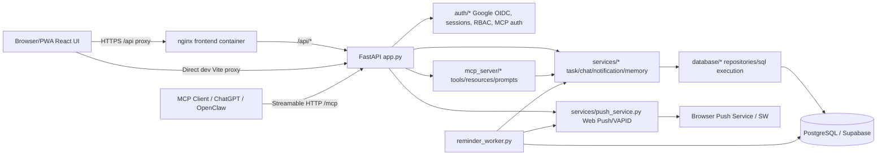
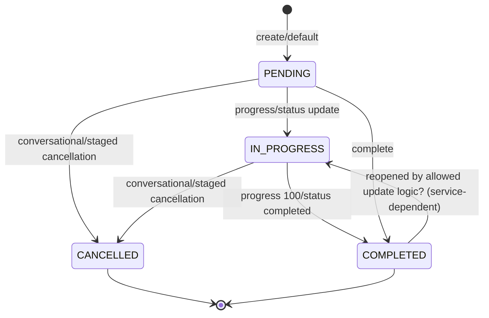
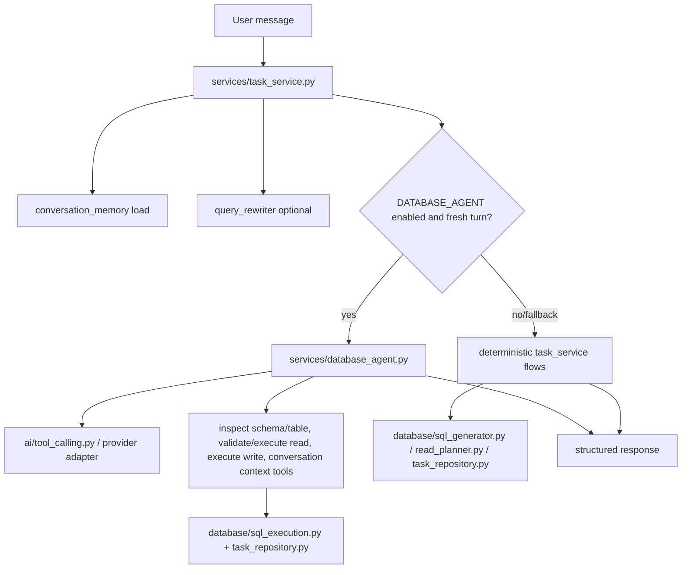
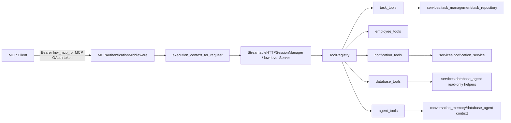
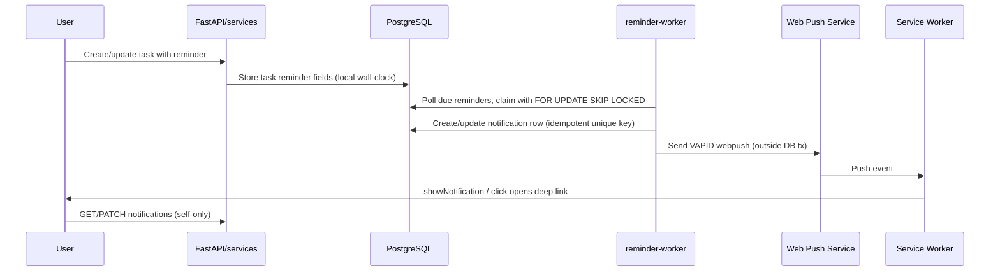

# FnW Task Manager / Task Flow Automation — Technical Handover

> **Documentation-only handover.** This file was created from repository inspection on 2026-11-27. It does not change application behavior, schema, deployment state, or Git history. Claims are labeled as **Implemented** (present in code/config), **Verified** (confirmed by repo evidence/static inspection), or **Not verified from the current repository** (requires runtime/environment/external system access).

## 1. Executive Summary

Task Flow Automation / FnW Task Logging Assistant is a Python/FastAPI backend + React/Vite frontend for employee-scoped task management. It supports natural-language task workflows (chat/text/voice), PostgreSQL persistence, Google OAuth authentication with DB-backed RBAC, reminder notifications with Web Push/PWA service worker support, and a Streamable HTTP MCP server mounted inside the same FastAPI app.

**Current repository snapshot (verified):**
- Branch: `feat/dual-mode-mcp`
- HEAD: `a875c8ea2de64e6e818525b31baa140bcd4b2790` (`a875c8e Fix MCP OAuth routes and add audit tests`, 2026-11-23)
- Remote: `origin https://github.com/AbhayShinde16325/FnW-logging-assistant.git`
- Working tree is dirty and contains unrelated/uncommitted changes; see [Section 6](#6-repository-state-and-git-context) and [Section 31](#31-known-issues-risks-and-technical-debt).

## 2. Scope, Method, and Evidence Rules

### Scope
- Inspected tracked files, key configs, docs, backend/frontend source, migrations, tests, scripts, Docker/tunnel assets, and git metadata.
- No production DB connections, no destructive commands, no dependency installs, no test execution, no application code changes.

### Evidence rules
- **Implemented**: code/config present in repository.
- **Verified (static)**: confirmed by reading files, git metadata, or command output in this workspace.
- **Not verified from the current repository**: runtime behavior, deployed Render/Supabase/Google Cloud state, live credentials, real browser push delivery, external MCP client behavior, or CI results not present locally.

### Commands/evidence used
- `git branch --show-current`, `git remote -v`, `git log --oneline -15`, `git status --short`, `git branch -a`, `git rev-parse HEAD`
- `git ls-files`, file inventory, targeted `sed`/`grep`/`python` inspection
- Route/env/symbol extraction via Python AST/regex scans

## 3. Product Purpose and Primary Users

**Purpose (implemented):** Help employees create, find, update, complete, and delete tasks through UI/chat/voice; provide reminders and notifications; expose controlled task capabilities through MCP for authorized clients.

**Primary users/actors:**
- **Employee**: self-scoped task access; can create/manage/delete own assigned tasks per RBAC and service rules.
- **Manager**: broader task/employee operational permissions; cannot perform admin-only role/admin-target actions.
- **Administrator**: full canonical permissions including role/admin management.
- **External MCP client**: ChatGPT/OpenClaw/MCP client using dedicated `fnw_mcp_...` credential or MCP OAuth token, constrained by same employee RBAC/ownership.

## 4. High-Level Architecture



**Key boundary (implemented):** FastAPI routes parse/authorize and delegate; services enforce business rules; repositories/SQL execution handle DB access; MCP tools wrap existing services and never become a second business-logic source.

## 5. Repository Layout

| Path | Purpose |
| --- | --- |
| `app.py` | FastAPI app, lifespan, middleware, CORS, router registration, MCP mount, task/chat/voice/feedback endpoints. |
| `auth/` | Google OIDC, JWT/session security, RBAC dependencies, employee management, MCP credentials, MCP OAuth. |
| `database/` | SQLAlchemy models/engine, repositories, SQL validation/generation/planning, search, task field mapping. |
| `services/` | Task/chat orchestration, task management, scope/RBAC helpers, notifications, push, conversation memory, query rewrite, missing-field follow-up. |
| `mcp_server/` | Streamable HTTP MCP server, auth/authz/context, tool registry, tools/resources/prompts. |
| `ai/` | Intent detection, extraction/tool-calling/provider adapters, MCP client adapter, reminder/query-session helpers. |
| `frontend/` | React/Vite PWA UI, auth/notification/permission helpers, service worker. |
| `migrations/` | Alembic env and versioned migrations. |
| `tests/` | Pytest suite for auth, MCP, tasks, SQL, reminders, notifications, voice, frontend-adjacent behavior. |
| `docs/MCP_ARCHITECTURE.md` | MCP deployment/auth/tool architecture. |
| `tunnel/` | Dev tunnel Dockerfile/config/entrypoint for OpenAI tunnel client. |
| `scripts/` | OAuth config check, VAPID key generation. |
| `.agents/skills/` | SQL generation and reminder-notifications skill docs. |

## 6. Repository State and Git Context

**Verified git state:**
- Current branch: `feat/dual-mode-mcp`
- HEAD: `a875c8e` - "Fix MCP OAuth routes and add audit tests" (2026-11-23)
- `master` tracks `origin/master` at `875d607 fix: bootstrap CSRF for production OAuth sessions`
- Remote branches include `feat/dual-mode-mcp`, `master`, `feature/voice-stt`, `hermes-switch-phase1`.

**Dirty worktree (pre-existing, not modified by this handover):**

| Status | Path | Handover relevance |
| --- | --- | --- |
| M | `.env.example` | Env doc changes, `RUN_MIGRATIONS` default/comment. |
| M | `.gitignore` | Ignores `/secrets/`, `/vapid-generated.env`. |
| M | `app.py` | Notification follow-up respond endpoint, chat `notification_id`. |
| M | `docker-compose.yml` | `RUN_MIGRATIONS` default changed to `0`. |
| M | `docker-entrypoint.sh` | Safer migration gate/logging. |
| M | `frontend/src/App.css` | Notification/action styling additions. |
| M | `frontend/src/App.jsx` | Notification follow-up UI, deep-link follow-up, chat context. |
| M | `frontend/src/notifications.js` | `isFollowupNotification` helper. |
| M | `notification_routes.py` | Delete notification/all endpoints. |
| M | `services/database_agent.py` | Notification context/tool prompt/rules updates. |
| M | `services/notification_service.py` | Missing-details type, delete APIs, event notification idempotency. |
| M | `services/task_management.py` | Assignment notification creation/details. |
| M | `services/task_service.py` | Large follow-up/cancellation/post-followup/notification-context changes. |
| M | `tests/test_task_service.py` | Related test adjustments. |
| ?? | `services/missing_field_followup.py` | Untracked follow-up service. |
| ?? | `tests/test_assignment_notifications.py` | Untracked tests. |
| ?? | `tests/test_missing_field_followup.py` | Untracked tests. |
| ?? | `tests/test_notification_followup_context.py` | Untracked tests. |
| ?? | `tests/test_task_cancellation.py` | Untracked tests. |
| ?? | `tests/test_task_proactive_followup.py` | Untracked tests. |

**Sensitive/untracked local files present (do not expose):** `.env`, `secrets/vapid-private.pem`, `tunnel/bin/tunnel-client`, `tunnel/secrets/fnw-mcp-authorization`. `.gitignore` and `.dockerignore` exclude secrets/env/tunnel secrets.

## 7. Runtime Entrypoints and Startup Lifecycle

### Backend entrypoint
- **Implemented:** `app.py` creates `FastAPI(...)` with `lifespan`.
- **Startup (`lifespan`)**: validates secure auth config when `AUTH_REQUIRED`; calls `create_tables()`; loads MCP settings; if MCP enabled, optionally reconciles bootstrap MCP credential only for non-production tunnel-enabled mode; enters `mcp_server.server.mcp_lifespan()` when MCP enabled.
- **Shutdown:** lifespan exits; MCP session manager context exits.

### Routers mounted
- `auth.routes.router` (`/auth`, tags auth)
- `auth.mcp_oauth_routes.router` (MCP OAuth metadata/endpoints)
- `auth.mcp_credential_routes.router` (`/auth/mcp-credentials`)
- `auth.employee_routes.router` (`/employees`)
- `notification_routes.router` (notifications/push)
- App routes in `app.py` for health/tasks/chat/voice/feedback/notification follow-up respond.

### MCP mount
- **Implemented:** if `MCP_ENABLED`, `mcp_server.server.mount_mcp(app)` mounts ASGI app at `settings.path` (default `/mcp`) and registers RFC 9728 protected-resource metadata routes.

### Worker entrypoint
- **Implemented:** `reminder_worker.py` runs polling loop, handles SIGTERM/SIGINT, optional `REMINDER_WORKER_ONCE`.

### Frontend entrypoints
- Vite app: `frontend/src/main.jsx` renders `App.jsx`.
- Nginx serves SPA, proxies `/api/` to backend, special cache headers for `sw.js` and `manifest.webmanifest`.

## 8. Configuration and Environment Variables

**Sources:** `.env.example`, `config.py`, `auth/config.py`, `mcp_server/configuration.py`, `database/connection.py`, `services/notification_service.py`, `services/push_service.py`, `docker-compose*.yml`, frontend `import.meta.env`.

### Core/runtime

| Variable | Default / Example | Used by | Notes |
| --- | --- | --- | --- |
| `DATABASE_URL` | required | `database/connection.py`, Alembic | Normalized to `postgresql+psycopg://`; Supabase SSL handled; pooler disables prepared statements. |
| `COHERE_API_KEY` | empty | AI providers/tool calling | Required for live Cohere features; not verified here. |
| `AI_PROVIDER` | `cohere` | `ai/providers/provider_factory.py` | Only `cohere` implemented. |
| `TIMEZONE` | `Asia/Kolkata` | `config.py`, datetime/reminder logic | Default app timezone. |
| `TASK_REQUIRED_FIELDS` | title/description/assignee/deadline date/time | `ai/query_session.py` | Controls progressive create required fields. |
| `CORS_ORIGINS` | `http://localhost:5173` | `app.py` | Comma-separated origins. |
| `APP_ENV` | `development` | MCP/auth/deployment behavior | `production` affects MCP tunnel/bootstrap defaults. |

### Auth/Google/session

| Variable | Default | Notes |
| --- | --- | --- |
| `AUTH_REQUIRED` | `true` | Tests often set `0`; production should be true. |
| `AUTH_SECRET_KEY` | empty | Must be >=32 chars when auth required. |
| `AUTH_TOKEN_ISSUER` / `AUTH_TOKEN_AUDIENCE` | task-flow defaults | JWT claims validation. |
| `ACCESS_TOKEN_MINUTES` | 15 (5-60 clamp) | Short-lived access token. |
| `REFRESH_TOKEN_DAYS` | 14 (1-30 clamp) | Refresh session TTL. |
| `AUTH_COOKIE_*` | secure/samesite/domain/cookie names | Refresh/CSRF/OAuth state cookies. |
| `GOOGLE_*` | endpoints/client/secret/redirect/JWKS | Google OIDC code+PKCE flow. |
| `FRONTEND_URL` | `http://localhost:8080` | Allowed frontend origins CSV. |
| `AUTH_POST_LOGIN_REDIRECT` | frontend origin | Must match allowed frontend origin. |
| `AUTH_ALLOWED_EMAIL_DOMAIN` | optional | Restricts Google email domain. |
| `BOOTSTRAP_ADMIN_*` | optional | Bootstrap admin command. |

### MCP

| Variable | Default | Notes |
| --- | --- | --- |
| `MCP_ENABLED` | false | Mounts MCP server when true. |
| `MCP_TRANSPORT` | `streamable-http` | Only supported transport. |
| `MCP_PATH` | `/mcp` | Mount path. |
| `MCP_REQUIRE_AUTH` | true | Bearer auth required. |
| `MCP_SERVER_URL` | `http://127.0.0.1:8000/mcp` | Internal adapter URL; keep local. |
| `MCP_PUBLIC_RESOURCE_URL` | empty | Public resource/metadata URL; canonicalized to include `/mcp`. |
| `MCP_TUNNEL_ENABLED` | env-dependent | Dev tunnel mode; default false in production. |
| `MCP_STATELESS`, `MCP_JSON_RESPONSE` | true | Streamable HTTP manager options. |
| `MCP_*` limits/timeouts/DNS rebinding/allowed hosts/origins | see config | Transport/security settings. |
| `MCP_BOOTSTRAP_*` | dev/tunnel bootstrap | Reconciled only in non-production tunnel mode. |

### Notifications/push/reminders

| Variable | Default | Notes |
| --- | --- | --- |
| `VAPID_PUBLIC_KEY` | empty | Public key exposed by `/push/public-key`. |
| `VAPID_PRIVATE_KEY` / `VAPID_PRIVATE_KEY_PATH` | empty | Server-only; never expose. |
| `VAPID_SUBJECT` | `mailto:admin@example.com` | VAPID claim subject. |
| `REMINDER_POLL_SECONDS` | 20 | Worker poll interval. |
| `REMINDER_BATCH_SIZE` | 100 | Claim batch size. |
| `REMINDER_MAX_RETRIES` | 5 | Push retry cap. |
| `REMINDER_MAX_AGE_HOURS` | 168 | Skip stale reminders. |
| `REMINDER_PROCESSING_TIMEOUT_SECONDS` | 300 | Stale PROCESSING recovery. |
| `REMINDER_RETRY_BASE_SECONDS` / `MAX_SECONDS` | 30 / 900 | Exponential backoff. |

### Frontend

| Variable | Default | Notes |
| --- | --- | --- |
| `VITE_API_BASE_URL` | `http://localhost:8000` | Frontend API base (`frontend/src/auth.js`). |
| `VITE_VAPID_PUBLIC_KEY` | not used by inspected frontend | **Not verified as consumed by frontend code**; backend `/push/public-key` is used. Documented as investigation area. |

## 9. Authentication, Sessions, and RBAC

### Google OIDC login (implemented)
- `GET /auth/google/login`: creates PKCE pair, signed state token (includes nonce, verifier, return_to, optional MCP OAuth payload), sets OAuth state cookie, redirects to Google.
- `GET /auth/google/callback`: validates state cookie/token, exchanges code, verifies ID token (issuer/audience/RS256 JWKS/nonce/email_verified), resolves pre-provisioned active employee by `google_sub` or email; first successful login links `google_sub`.
- Domain restriction: `AUTH_ALLOWED_EMAIL_DOMAIN`.
- No public registration; unknown/inactive employee redirected with safe auth error.

### Session/token model
- Access token: short-lived JWT in frontend memory.
- Refresh token: random token, hash stored in `sessions` table, HttpOnly cookie; rotated on `/auth/refresh`; CSRF cookie + `X-CSRF-Token` required.
- Reuse detection: revoked rotated refresh token reuse outside grace window revokes employee sessions; benign recent duplicate handled as `RotatedTokenError`.
- `POST /auth/logout`, `/auth/logout-all`, `GET /auth/csrf`, `GET /auth/me`.

### RBAC
- Canonical roles: `ADMIN`, `MANAGER`, `EMPLOYEE`.
- Canonical permissions include task read/create/update/delete/read_all/update_all, employee read/manage, roles.manage, reports.read.
- Dependencies: `get_current_employee`, `require_permission`, `require_any_permission`.
- Task ownership enforced through `Task.assigned_to_employee_id`; display names are not authorization.

## 10. Employee Management

**Implemented endpoints (`/employees`, admin/manager with `employees.manage`):** list/detail/create/update/activate/deactivate/revoke sessions; also MCP credential list/revoke for target employee.

**Rules:**
- Self role change blocked.
- Admin-target management requires `roles.manage`.
- Deactivate/revoke sessions guarded against removing last active admin.
- Audit events logged via `auth/audit.py` logger `taskflow.audit`.

**Not verified:** production admin bootstrap execution/state, actual Google Workspace provisioning process.

## 11. Task Domain Model and Schema

### Core task fields (from `database/models.py` / schema docs)
- `id`, `task_title`, `task_description`, `assigned_to` (legacy display), `created_by_employee_id`, `assigned_to_employee_id`, assigned/deadline/reminder date/time, `status`, `progress`.

### Value rules
- Status: `PENDING`, `IN_PROGRESS`, `COMPLETED`.
- Progress: 0-100.
- `COMPLETED` => progress 100; progress > 0 cannot be PENDING.
- Reminder must have both date/time or neither; reminder must be before/at deadline; past reminders rejected by validation/service rules.
- Reminder/deadline are distinct fields.

### Other tables
- Auth/RBAC: `roles`, `permissions`, `role_permissions`, `employees`, `sessions`.
- MCP: `mcp_client_credentials`, `mcp_oauth_clients`, `mcp_oauth_codes`, `mcp_oauth_sessions`.
- Notifications/push: `notifications`, `push_subscriptions`.
- Conversation memory: `conversation_memory` (app-internal, not SQL-skill table).

## 12. Task Lifecycle and Business Rules



**Implemented rules (verified in services):**
- Create: `task_management.create_task` validates title, resolves assignee, enforces self-assignment for employee self-service, validates status/progress sync, validates reminder schedule.
- Update: permission/ownership checks, no reassignment by self-service employee, validates updates, syncs status/progress, revalidates reminder/deadline.
- Progress-only endpoint uses `update_progress` and syncs status.
- Delete: requires `CONFIRM DELETE` at API layer; cancels pending notifications before repo delete.
- Task visibility: `task_scope` + repository scoping by `assigned_to_employee_id`; managers/admins with read_all see broader scope.

## 13. Conversational Task Flows

### Main flow components
- `ai/intent_detection.py`: rule-based intent classification (`CREATE_TASK`, `UPDATE_TASK`, `GET_TASK`, `LIST_TASKS`, `DELETE_TASK`, `CLARIFICATION_REQUIRED`, `GENERAL_QUERY`).
- `ai/text_extractor.py` + `ai/query_session.py`: staged extraction/draft/confirmation engines.
- `services/task_service.py`: orchestrates chat/voice turns, memory, rewrite, agent path, deterministic flows, selection/confirmation/cancellation/post-followup.
- `services/conversation_memory.py`: persistent per-user+conversation memory.
- `services/query_rewriter.py`: follow-up rewrite with safety checks.

### Staged create/update behavior
- Create stages: `fields`, `confirm_fields`, `reminder`, `confirm_reminder`.
- Update/delete stages: `select_task`, `confirm_update`, `confirm_delete`.
- Cancellation phrases/backtrack/post-followup logic implemented in dirty working tree changes in `task_service.py`.

### Notification follow-up context (current worktree)
- `app.py` adds `POST /notifications/{notification_id}/followup/respond` and chat `notification_id`.
- `services/task_service.py` loads notification context, persists to conversation memory, handles deterministic follow-up messages via `_handle_notification_followup_message`, and routes to `task_management` for updates.
- `services/missing_field_followup.py` (untracked) stores follow-up state in notification payload; no schema change.
- **Regression check requested:** `_handle_notification_followup_message()` currently calls `task_management.get_task_for_actor(...)`; `task_management` is imported in `task_service.py` (`from services import missing_field_followup, task_management`). Static inspection suggests import/call path exists in current worktree; runtime behavior not verified.

## 14. AI / LLM / Agent Architecture



**Implemented details:**
- Provider abstraction: `ai/providers/base.py`, `cohere_provider.py`, `provider_factory.py` (`AI_PROVIDER`, default cohere).
- Tool calling: `ai/tool_calling.py` has Cohere native tool-calling client, provider error classification, safe message adapter.
- Database agent: `services/database_agent.py` bounded loop, schema-aware prompt, read-only/read-bounded execution, employee scope enforcement, confirmation required for destructive writes.
- MCP-backed tool-calling adapter exists in `ai/mcp_client/*` for provider-agnostic tool discovery/invocation.
- Fallback deterministic path remains in `task_service.py`, `sql_generator.py`, `read_planner.py`, `agentic_read.py`.

## 15. SQL Safety and Data Access Layer

**Implemented controls:**
- `database/sql_execution.py` validates single statement, allowed operations, tasks-only table, no joins/prohibited ops, DELETE requires specific WHERE, confirmation phrases (`CONFIRM UPDATE/DELETE/DROP TABLE tasks`).
- Parameterized SQL only; no inlining untrusted values.
- `database/task_repository.py` executes reads with bounded row caps/timeouts and scoped access.
- `database/sql_generator.py` builds structured operations from schema; rejects unknown columns/values.
- `database/read_planner.py` provides schema-aware read planning and status semantics.

**Not verified:** actual DB permissions/roles in deployed Supabase beyond code intent.

## 16. MCP Server Architecture



**Implemented:**
- Endpoint: `MCP_PATH` default `/mcp`, Streamable HTTP, stateless JSON responses by default.
- Auth: MCP endpoint accepts dedicated `fnw_mcp_...` credentials or MCP OAuth access tokens; rejects missing/invalid credentials with 401 + `WWW-Authenticate`.
- Context: `MCPExecutionContext` binds authenticated employee and `TaskActor`; tools execute under `use_task_actor`.
- Registry: unique tool names, schema validation, permission-filtered discovery and execution checks.
- Resources: `fnw://docs/*` and `fnw://skills/*` from repo docs/skills.
- Prompts: task creation/update, database analysis, reminder management.

## 17. MCP Tools, Resources, and Prompts

### Tools (registered in `mcp_server/server.py`)
- Task: `create_task`, `get_task`, `list_tasks`, `search_tasks`, `update_task`, `update_task_status`, `update_task_progress`, `update_task_deadline`, `update_task_reminder`, `create_task_reminder`, `delete_task`.
- Employee: `get_current_employee`, `get_employee_profile`, `list_employees`, `get_employee_permissions`.
- Notifications: `list_notifications`, `get_unread_notification_count`, `mark_notification_read`, `mark_all_notifications_read`.
- Database/agent: `inspect_database_schema`, `inspect_table_definition`, `validate_sql_query`, `execute_read_query`, `retrieve_conversation_context`, `update_conversation_context`.

### Confirmation rules
- Write tools requiring confirmation: update/reminder/delete task tools expect exact employee confirmation phrase; in-process adapter overwrites confirmation from trusted user message.

### Resources/prompts
- Resources expose README, DB schema, MCP architecture, SQL/reminder skills.
- Prompts provide reusable safe instructions; skills are not tools.

## 18. MCP Deployment Modes and Tunnel

### Development
- `APP_ENV=development`, `MCP_TUNNEL_ENABLED` defaults true outside production.
- Compose dev profile can run `mcp-tunnel` service using `tunnel/Dockerfile`, `tunnel/config/fnw-chatgpt.compose.yaml`, secret mounted as `FNW_MCP_AUTHORIZATION_FILE`.
- Internal adapter URL should remain local (`MCP_SERVER_URL=http://127.0.0.1:8000/mcp`).

### Production
- `APP_ENV=production`, tunnel disabled by default; no tunnel container required.
- Public MCP endpoint: `https://fnw-logging-assistant.onrender.com/mcp` (documented). Metadata uses `MCP_PUBLIC_RESOURCE_URL`.
- Protected resource metadata includes `authorization_servers`, `authorization_endpoint`, `token_endpoint`, `registration_endpoint`, `scopes_supported=["mcp:tools"]`.

**Not verified:** live Render deployment, tunnel connectivity, ChatGPT workspace installation.

## 19. MCP OAuth and Credential Model

### Dedicated MCP credentials
- Prefix: `fnw_mcp_` (`MCP_CREDENTIAL_PREFIX` in `auth/mcp_credentials.py`).
- Plaintext shown once; SHA-256 hash stored. Validation checks active employee, not revoked/expired.
- Endpoints: `/auth/mcp-credentials` self-service and employee management revoke/list routes.

### MCP OAuth
- Authorization server metadata: `GET /.well-known/oauth-authorization-server`.
- Protected resource metadata: `/.well-known/oauth-protected-resource` and path-specific variant.
- Endpoints: `/oauth/authorize`, `/auth/mcp/callback` (internal), `/oauth/register`, `/oauth/token`, `/oauth/revoke`.
- PKCE S256, authorization_code + refresh_token, scope `mcp:tools`, dynamic client registration, resource validation.
- Access token audience/resource bound to canonical MCP resource.

### Known investigation point
- User noted prior behavior `authorization_servers: []`; current code sets `authorization_servers: [issuer]` in `mcp_server/server.py` and metadata helpers. **Static code indicates non-empty issuer; deployed runtime not verified.**

## 20. Notifications, Reminders, and Web Push



**Implemented:**
- `notifications` table stores persistent in-app records; push delivery tracked separately.
- Reminder worker claims due rows, retries transient failures, handles 404/410 as permanent endpoint failures, recovers stale processing rows.
- Notification routes are self-scoped to authenticated employee.
- Frontend registers service worker, subscribes via backend public VAPID key, displays notification center, handles deep links.
- Assignment notifications and missing-detail follow-up are present in current dirty worktree/untracked files.

**Caveats:**
- Web Push requires HTTPS outside localhost; iOS requires Home Screen web app behavior. **Not verified in real devices here.**
- Sound cannot bypass OS/browser restrictions.

## 21. Frontend Application

**Stack:** React 19, Vite 8, ESLint 10, Node tests (`node --test` for selected src tests).

**Main UI (`frontend/src/App.jsx`):**
- Auth bootstrap/refresh/login/logout.
- Tabs: Assistant, Tasks, Employees (role-gated).
- Chat/voice task assistant with staged conversation state.
- Task table/progress/edit/delete/create flows depending on permissions.
- Notification bell/panel, unread count, mark read/all, delete (dirty worktree adds delete), timezone settings, push subscribe/test controls.
- Deep-link task opening via query params `task`, `notification`, `followup`.

**Service worker (`frontend/public/sw.js`):** handles push display, click navigation/focus, posts messages to clients.

## 22. Frontend-to-Backend Integration

| Frontend area | API |
| --- | --- |
| Auth | `/auth/csrf`, `/auth/google/login`, `/auth/refresh`, `/auth/logout`, `/auth/logout-all`, `/auth/me` |
| Tasks/chat/voice | `/tasks`, `/tasks/{id}`, `/tasks/{id}/progress`, `/tasks/chat`, `/tasks/text`, `/tasks/voice`, `/tasks/voice/turn`, `/feedback` |
| Employees | `/employees...` |
| Notifications/push | `/notifications`, `/notifications/unread-count`, `/notifications/settings`, `/notifications/{id}/read`, `/notifications/read-all`, `/notifications/{id}/followup/respond` (app.py), `/push/public-key`, `/push/subscribe`, `/push/subscriptions`, `/push/test` |

**Auth behavior:** `frontend/src/auth.js` uses cookie credentials, CSRF bootstrap/retry on refresh 403, refresh lock, bearer access token in memory.

## 23. Database Schema and Migrations

**Migration chain (verified):** `0001_auth_rbac` -> `0002_rbac_task_policy` -> `0002a_create_core_tables` -> `0003_reminder_notifications` -> `0004_intelligent_notification_fields` -> `0005_ensure_notification_metadata` -> `0006_employee_task_self_service` -> `0007_refresh_session_replacement` -> `0008_add_mcp_client_credentials`.

**Notes:**
- Migrations are additive/guarded in many places for deployment safety.
- `database/connection.create_tables()` also performs small safe additive column checks for legacy/bootstrap compatibility; Alembic is authoritative for deployment.
- `conversation_memory` and notification/auth tables are app-internal; SQL skill/table guardrails target `tasks` only.

## 24. Docker, Local Dev, and Runtime Topology

### Docker Compose (default `docker-compose.yml`)
- `backend`: FastAPI/Uvicorn on 8000, optional migrations (`RUN_MIGRATIONS` default now `0` in dirty worktree), env for DB/auth/MCP/push.
- `reminder-worker`: same image, `python -m reminder_worker`, `RUN_MIGRATIONS=0`.
- `frontend`: nginx serving built React app on 8080, proxies `/api`.
- `mcp-tunnel`: optional dev profile.

### Local DB overlay
- `docker-compose.local-db.yml` adds local Postgres 16 and overrides `DATABASE_URL` for backend/worker.

### Dockerfiles
- Root `Dockerfile`: Python 3.11 slim, installs requirements + ffmpeg, non-root `app`, entrypoint runs Alembic conditionally.
- `frontend/Dockerfile`: Node build then nginx runtime.
- `tunnel/Dockerfile`: debian slim with tunnel client binary/config/entrypoint.

## 25. Environment Matrix

| Mode | DB | MCP | Tunnel | Auth | Notes |
| --- | --- | --- | --- | --- | --- |
| Local dev (non-docker) | local/external DATABASE_URL | optional | no | can be relaxed for tests only | `uvicorn` + `vite`. |
| Docker external DB (default) | Supabase/external | optional | optional dev profile | required in real deployment | No local db service. |
| Docker local DB overlay | local postgres container | optional | optional | configurable | for isolated dev/testing. |
| Production/Render | managed Postgres/Supabase | enabled | disabled | required | direct HTTPS `/mcp`, no tunnel container. |
| Tests | sqlite/postgres depending test | often disabled | no | `AUTH_REQUIRED=0` by default in conftest | some DB tests skipped if unavailable. |

## 26. External Integrations

| Integration | Purpose | Auth/Secrets | Verification |
| --- | --- | --- | --- |
| Google OIDC | Employee login | `GOOGLE_CLIENT_ID/SECRET`, redirect URI | Code implemented; live Google Console config not verified. |
| PostgreSQL/Supabase | Primary data store | `DATABASE_URL` | Code implemented; live DB not verified. |
| Cohere | LLM extraction/tool-calling | `COHERE_API_KEY` | Code implemented; live key/model behavior not verified. |
| Web Push services | Browser push delivery | VAPID keys | Code implemented; real push delivery not verified. |
| OpenAI tunnel / MCP clients | Dev remote MCP access | tunnel control plane key, MCP credential/OAuth | Code/config present; live tunnel/client not verified. |

## 27. Observability, Logging, and Auditing

- Python logging configured in `app.py` and several services.
- `auth/audit.py` logs employee management audit events as structured JSON via `taskflow.audit` logger.
- MCP auth logs rejection reasons without token secrets.
- Reminder worker logs cycle stats and delivery errors; push service logs sanitized provider origin/status.
- **Not verified:** centralized log aggregation, alerting, metrics/tracing, production log retention.

## 28. Security Model

- Google OIDC with state/nonce/PKCE/JWKS verification; no public signup.
- Access token in memory; refresh token HttpOnly cookie + CSRF cookie/header.
- RBAC enforced in dependencies and services; task ownership by employee id.
- SQL guardrails: tasks-only, parameterized, confirmation for destructive ops.
- MCP auth required; separate MCP credential/OAuth token models; no browser JWT acceptance on MCP credential path as identity shortcut except MCP OAuth/JWT types designed for MCP.
- Secrets excluded by `.gitignore`/`.dockerignore`; private keys must not be committed.
- **Risks:** dirty worktree includes local secret files in workspace; ensure never committed. `AUTH_REQUIRED=0` test mode must not be used in production.

## 29. Testing and Verification Status

### Existing automated tests (repo)
- Backend pytest suite under `tests/` covers auth/RBAC, MCP server/oauth/credentials, SQL generation/execution/planner, task flows/intents, reminders/notifications, conversation memory, voice, tool-calling, etc.
- Frontend Node tests: `src/permissions.test.js`, `src/notifications.test.js`, `src/assistantAlerts.test.js`, `src/greeting.test.js`.

### Commands documented
```bash
AGENTIC_READ=0 DATABASE_AGENT=0 python -m pytest tests -q
cd frontend && npm run lint && npm test && npm run build
alembic upgrade head  # validate on temp DB
```

### Verification performed in this handover
- Static inspection only: file reads, grep/AST scans, git metadata. **No tests executed.**

### Not verified
- Test pass/fail in current dirty worktree.
- Runtime migrations against Supabase/production.
- Real browser push, iOS PWA push, Google OAuth live flow, Render MCP endpoint, tunnel.

## 30. Deployment and Operations Runbook

### Docker quick start
```bash
cp .env.example .env
# set DATABASE_URL, COHERE_API_KEY, AUTH_SECRET_KEY, GOOGLE_*, VAPID_*
docker compose up -d --build
docker compose exec backend python -m auth.bootstrap --email you@example.com
```

### Local DB overlay
```bash
docker compose -f docker-compose.yml -f docker-compose.local-db.yml up -d --build
```

### Dev MCP tunnel
```bash
docker compose --profile dev up -d --build
```

### Health checks
- `GET /health`
- `docker compose ps`
- `docker compose logs -f backend`
- `docker compose logs -f reminder-worker`

### Production notes
- Set `APP_ENV=production`, `AUTH_REQUIRED=true`, `AUTH_COOKIE_SECURE=true`, HTTPS URLs, `MCP_PUBLIC_RESOURCE_URL`.
- Keep `MCP_SERVER_URL` internal/local.
- Run migrations intentionally (`RUN_MIGRATIONS` controlled; default changed to 0 in dirty worktree).

## 31. Known Issues, Risks, and Technical Debt

1. **Dirty/uncommitted worktree** - many modified and untracked files; handover describes both HEAD and current worktree where relevant. Risk of mixing concerns.
2. **Notification follow-up regression area** - user flagged `_handle_notification_followup_message()` / `task_management.get_task_for_actor(...)` import. Current worktree shows import present and calls through `task_management`; runtime not verified. Untracked `services/missing_field_followup.py` and related tests are not committed.
3. **MCP OAuth metadata `authorization_servers`** - previously reported empty; current static code returns issuer. Deployed environment not verified.
4. **Large orchestration modules** - `services/task_service.py` (~4106 lines), `frontend/src/App.jsx` (~3833 lines) increase change risk.
5. **Dual migration/bootstrap behavior** - Alembic and `create_tables()` additive checks can mask drift; production should use controlled Alembic path.
6. **Push delivery realism** - automated tests mock push; real device/browser behavior unverified.
7. **Local secrets present in workspace** - `.env`, VAPID private key, tunnel authorization file exist locally but are ignored; operational risk if copied/shared.
8. **No CI workflow files found** in `.github/workflows` (not present). **Not verified from the current repository** whether external CI exists.

## 32. Incomplete, Unverified, or Ambiguous Areas

- Render deployment state, env vars, and public MCP endpoint behavior.
- Supabase schema/current migration head in production.
- Google OAuth client configuration and consent screen.
- Real Web Push delivery on desktop/iOS PWA.
- Cohere model availability/rate limits in target environment.
- Whether dirty worktree changes are intended for merge.
- `VITE_VAPID_PUBLIC_KEY` is mentioned by handover request context; frontend currently fetches `/push/public-key` from backend. No frontend consumption of `VITE_VAPID_PUBLIC_KEY` verified.
- Test results and lint/typecheck status.

## 33. Recommended Next Steps

1. **Stabilize worktree**: review/commit or stash dirty files by concern (notification follow-up, MCP/auth, docs). Add tests for missing-field follow-up and notification context to CI.
2. **Verify MCP OAuth in deployed env**: confirm `/.well-known/oauth-authorization-server` and `/.well-known/oauth-protected-resource/mcp` return expected issuer/resource and non-empty `authorization_servers`.
3. **Run full verification in clean environment**: backend pytest with required env, frontend lint/test/build, Alembic upgrade on temp DB.
4. **Security pass**: rotate any secrets that may have been exposed in local tooling/logs; confirm `.env`/secrets never committed; review auth cookie/CORS settings for production domains.
5. **Operationalize observability**: add structured request IDs, metrics, alerting for reminder worker failures/push rejection rates.
6. **Refactor hotspots**: split `task_service.py` and `App.jsx` by domain flows; preserve behavior with characterization tests.

## 34. File-by-File Reference Map (High Value)

| File | Role | Key symbols/notes |
| --- | --- | --- |
| `app.py` | API entrypoint | `lifespan`, `handle_chat`, `handle_voice`, `respond_notification_followup`, task CRUD endpoints. |
| `config.py` | App config | `TIMEZONE`. |
| `database/models.py` | ORM schema | `Task`, `Notification`, `ConversationMemory`, auth/MCP tables. |
| `database/task_repository.py` | DB access | scoped task CRUD/search/read SQL helpers. |
| `database/sql_execution.py` | SQL guardrails | `validate_sql`, confirmation enforcement. |
| `services/task_service.py` | Conversation orchestration | `process_chat_turn`, staged flows, memory, cancellation/follow-up logic. |
| `services/task_management.py` | Authorized task CRUD | create/update/progress/delete, assignment notifications. |
| `services/notification_service.py` | Notification/push domain | scheduling, serialization, push subscription, worker helpers. |
| `reminder_worker.py` | Worker process | poll loop, `ReminderWorker`. |
| `auth/routes.py` | Auth endpoints | Google login/callback, refresh/logout/CSRF. |
| `auth/service.py` | Authn/session | session rotation/reuse detection, identity. |
| `auth/mcp_oauth.py` | MCP OAuth | PKCE, code/token/revoke, metadata. |
| `mcp_server/server.py` | MCP server | tool registration, metadata routes, mount. |
| `frontend/src/App.jsx` | Main UI | assistant/tasks/employees/notifications. |
| `frontend/public/sw.js` | PWA push | push/notificationclick handlers. |

## 35. API Reference Summary

### App routes (`app.py`)
- `GET /health`
- `POST /feedback`, `POST /tasks/feedback`
- `GET /tasks`, `POST /tasks`
- `POST /tasks/chat`, `POST /tasks/text`, `POST /tasks/voice`, `POST /tasks/voice/turn`
- `GET/PATCH/DELETE /tasks/{task_id}`, `PATCH /tasks/{task_id}/progress`
- `POST /notifications/{notification_id}/followup/respond` (dirty worktree)

### Auth routes (`/auth`)
- `GET /google/login`, `GET /google/callback`, `GET /csrf`, `POST /refresh`, `POST /logout`, `POST /logout-all`, `GET /me`

### Employee routes (`/employees`)
- List/create/detail/update/activate/deactivate/revoke-sessions, MCP credential admin endpoints.

### MCP credential routes (`/auth/mcp-credentials`)
- Self list/create/revoke.

### MCP OAuth routes
- `/.well-known/oauth-authorization-server`, `/oauth/authorize`, `/auth/mcp/callback`, `/oauth/register`, `/oauth/token`, `/oauth/revoke`.

### Notification routes
- Notifications CRUD/read settings, push public key/subscribe/unsubscribe/subscriptions/test.

## 36. Data Contracts and State Shapes

### Task API payload
- Includes task fields, status/progress, assigned/created employee IDs, reminder/deadline date/time, serialized as JSON-friendly values.

### Chat/voice state
- `stage`, `draft`, `answers`, `reminder_text`, `confirm`, `confirm_delete`, `conversation_id`, `user_id` (backend derives/overrides identity), `notification_id` (dirty worktree).

### Notification payload
- Includes `id`, `employee_id`, `task_id`, `title`, `message`, `notification_type`, `priority`, `voice_text`, `is_read`, scheduled/created/delivered timestamps, delivery status/error, destination URL, metadata payload.

## 37. Glossary

- **TaskActor**: request-scoped authenticated employee identity/permissions used for task scoping.
- **MCP credential**: dedicated `fnw_mcp_...` bearer token for MCP endpoint only.
- **MCP OAuth token**: OAuth-issued MCP access token with resource/audience bound to MCP resource.
- **Follow-up notification**: notification requiring user action for missing task details; state stored in notification payload/conversation context.
- **Dirty worktree**: local uncommitted modifications/untracked files present before this handover.

## 38. Handover Audit Checklist

- [x] `handover-readme.md` created at project root.
- [x] Documentation-only; no app code/config/tests/migrations changed.
- [x] Git state and dirty worktree documented.
- [x] Architecture, auth/RBAC, task flows, AI/SQL safety, MCP, notifications/push, frontend, DB/migrations, Docker, tests, risks, and next steps covered.
- [x] Mermaid diagrams included.
- [x] Unverified areas explicitly labeled.
- [x] Sensitive local secret values not reproduced.

**Final confirmation:** The only file created/modified by this handover task is `handover-readme.md`.
